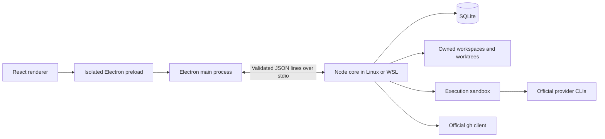

# Architecture

Vibestar separates the desktop interface from the local authority that owns processes, Git,
workspaces and saved state. This page is a map of those boundaries; operational and compatibility
details live in the linked guides.

## System overview

On Linux, Electron and the Node core run on the host. On Windows, Electron presents the desktop and
starts the core inside a selected WSL distribution. Git, provider tools, SQLite and task data remain
in Linux. The application uses a narrow stdio bridge rather than an application HTTP server.

## Runtime boundaries

The React renderer presents saved and observed state. It has no Node integration. Electron keeps
context isolation and Chromium sandboxing enabled. The preload exposes a typed API; the main process
validates the sender and forwards requests to the core. Compatibility negotiation prevents a newer
renderer from sending unsupported mutations to an older WSL helper.

The core validates each request and owns database access, filesystem operations, Git, process
lifecycles and provider invocation. Repository content, issue text and model output provide context;
they do not grant permission to mutate host data. Core-managed provider and verification commands
run inside the required sandbox. The user-operated terminal runs with the user's Linux/WSL
permissions after workspace ownership checks. See the [security guide](docs/security.md).

## Module ownership

| Area                                                         | Responsibility                                                                    |
| ------------------------------------------------------------ | --------------------------------------------------------------------------------- |
| `electron/`                                                  | Desktop lifecycle, isolated preload, stdio bridge and platform contracts          |
| `src/app/`                                                   | Navigation, desktop composition and global actions                                |
| `src/features/`                                              | Feature-owned UI, local state and renderer workflows                              |
| `src/components/` and `src/hooks/`                           | Reusable controls and hooks shared across features                                |
| `backend/rpc/`                                               | Validated domain requests; `backend/rpc.ts` composes services and dispatch        |
| `backend/flows/`                                             | Viber profiles, graph contracts, run persistence, context and history projections |
| `backend/execution/`                                         | Shared scheduling, providers, sandbox, output, terminals and verification         |
| `backend/workspace/`                                         | Git operations, path ownership, worktrees and runtime mounts                      |
| `backend/storage/`                                           | SQLite lifecycle, migrations, recovery, inspection and conservative cleanup       |
| `backend/review/`, `backend/github/`, `backend/issue-watch/` | Pull-request, GitHub and issue-discovery services                                 |
| `tests/`                                                     | Unit, domain, integration, security, terminal and opt-in desktop/live coverage    |

Feature-specific code belongs with its owner. Shared renderer primitives stay under `src/components`
and ordered CSS chapters under `src/styles/`. Detailed folder and check ownership is documented in
the [contributor guide](CONTRIBUTING.md) and [testing guide](docs/testing.md).

## Viber and graph execution

Vibers are reusable profiles. Each task graph captures its own Viber instances, settings and
selected input bindings. A graph is a validated DAG of agent, command and approval nodes. Connections
describe dependencies; explicit bindings select the context delivered to a node. Layout is stored
separately from the executable graph revision.

An explicit start captures a saved revision. The engine schedules eligible nodes using shared task
slots, cancellation and maintenance state. Node attempts retain their input and execution snapshots
and link to the existing command, event, usage and verification records. Conversations capture one
selected Viber instance and cannot complete graph nodes. Approval and continuation actions validate
the captured settings and current workspace evidence. Restart marks unfinished runs interrupted; it
does not replay provider calls. See the [workflow contracts](docs/architecture/workflows.md).

Legacy task readers and migrations preserve older records for inspection and safe recovery. Missing
historical settings, inputs or approvals remain unknown; current defaults do not fill those gaps.
Existing migration and compatibility code is part of the saved-data boundary.

## Persistence, verification and recovery

SQLite migrations are additive and run with a private backup before upgrade. Recovery retains
corrupt record bytes and diagnostics. Data-root migration, task cleanup and workspace reuse validate
canonical paths and ownership; unknown or dirty work is preserved. See the
[storage and migration contracts](docs/architecture/workflows.md#storage-reset-and-task-disposal).

Verification keeps observed command outcomes, provider-reported results and missing environmental
prerequisites separate. A successful process does not prove tests passed, and a missing check does
not become a pass. Logs and output are bounded and redacted before persistence or display.

## Maintainer guides

- [Security boundaries](docs/security.md)
- [Development and platform setup](docs/development.md)
- [Test suites and desktop fixtures](docs/testing.md)
- [Viber, graph, repair and Issue Watch contracts](docs/architecture/workflows.md)
- [Contributing](CONTRIBUTING.md)
- [Third-party notices](docs/third-party-notices.md)
