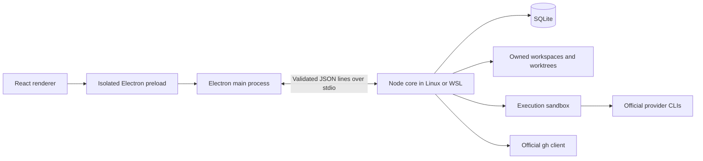

# Architecture

Vibestar separates the desktop interface from the local authority that owns processes, Git,
workspaces and saved state. This page is a map of those boundaries; operational and compatibility
details live in the linked guides.

## System overview

On Linux, Electron and the Node core run on the host. On Windows, Electron presents the desktop and
starts the core inside a selected WSL distribution. Git, provider tools, SQLite and task data remain
in Linux. The application uses a narrow stdio bridge rather than an application HTTP server.

## Runtime boundaries

The React renderer presents saved and observed state. It has no Node integration. Electron keeps
context isolation and Chromium sandboxing enabled. The preload exposes a typed API; the main process
validates the sender and forwards requests to the core. Compatibility negotiation prevents a newer
renderer from sending unsupported mutations to an older WSL helper.

The core validates each request and owns database access, filesystem operations, Git, process
lifecycles and provider invocation. Repository content, issue text and model output provide context;
they do not grant permission to mutate host data. Core-managed provider and verification commands
run inside the required sandbox. The user-operated terminal runs with the user's Linux/WSL
permissions after workspace ownership checks. See the [security guide](docs/security.md).

## Module ownership

| Area                                                               | Responsibility                                                                    |
| ------------------------------------------------------------------ | --------------------------------------------------------------------------------- |
| `apps/electron/`                                                   | Desktop lifecycle, isolated preload, stdio bridge and platform contracts          |
| `apps/desktop/app/`                                                | Navigation, desktop composition and global actions                                |
| `apps/desktop/features/`                                           | Feature-owned UI, local state and renderer workflows                              |
| `apps/desktop/components/` and `apps/desktop/hooks/`               | Reusable controls and hooks shared across features                                |
| `apps/core/rpc/`                                                   | Validated domain requests; `apps/core/rpc.ts` composes services and dispatch      |
| `apps/core/flows/`                                                 | Viber profiles, graph contracts, run persistence, context and history projections |
| `apps/core/execution/`                                             | Shared scheduling, providers, sandbox, output, terminals and verification         |
| `apps/core/workspace/`                                             | Git operations, path ownership, worktrees and runtime mounts                      |
| `apps/core/storage/`                                               | SQLite lifecycle, migrations, recovery, inspection and conservative cleanup       |
| `apps/core/review/`, `apps/core/github/`, `apps/core/issue-watch/` | Pull-request, GitHub and issue-discovery services                                 |
| `tests/`                                                           | Unit, domain, integration, security, terminal and opt-in desktop/live coverage    |

Feature-specific code belongs with its owner. Shared renderer primitives stay under `apps/desktop/components`
and ordered CSS chapters under `apps/desktop/styles/`. Detailed folder and check ownership is documented in
the [contributor guide](CONTRIBUTING.md) and [testing guide](docs/testing.md).

## Workspace overlays

Settings opens independently of page navigation in the shared `WorkspaceOverlay`. The native modal
keeps the current task/workflow mounted and makes the underlying interface inert, contains keyboard
focus and restores the opener on close. Select popovers use the modal's portal target so they remain
interactive in its top layer. Workspace shortcuts cannot run through the overlay.

Settings owns one long-lived autosave queue for core settings and another for desktop configuration,
including while the overlay is closed. Serialized field patches roll failures back to acknowledged
values without replaying a failed field in another setting's save. Changing the setting again
creates a new serialized save.
Visited panels retain local form values and scroll positions while the overlay is open. Desktop
configuration changes require native confirmation; the core atomically refuses restart when activity
exists and closes admission before stopping. Providers, Repositories and Storage reuse their existing
feature and guarded service boundaries.

One root `react-hot-toast` Toaster renders through `apps/desktop/lib/notifications.tsx`. It follows the active
native modal's top layer without stealing focus. The saved notification preference filters optional
messages; errors, required input, blocking warnings and essential runtime installation progress remain
visible. A display-only cache of the acknowledged preference covers startup before the core connects;
the core remains authoritative. Runtime status is cached by Electron so a renderer arriving after startup can display the
current stage. The existing WSL installer runs before helper loading only when bundled bytes, the
locked dependency manifest or native ABI/dependencies need recovery. It acquires the existing core
ownership lock and refuses runtime aliases. Custom helper paths remain user-managed. Retry probes
again; explicit Repair Runtime can reinstall. Linux launches bypass this WSL setup path.

Retired global Utility AI and Review AI fields are stripped when reading settings and disappear on the
next settings save; reads preserve original saved bytes. Historical analysis configurations and
`utility_ai` method labels remain readable. Current utility execution requires an operation-owned
configuration. Existing PR controls select a provider/model per operation and default to the provider
CLI; they no longer read a global model setting. No historical run is rewritten or replayed.

## Viber and graph execution

Vibers are reusable profiles. Each task graph captures its own Viber instances, settings and
selected input bindings. A graph is a validated DAG of agent, command and approval nodes. Connections
describe dependencies; explicit bindings select the context delivered to a node. Layout is stored
separately from the executable graph revision.

An explicit start captures a saved revision. The engine schedules eligible nodes using shared task
slots, cancellation and maintenance state. Node attempts retain their input and execution snapshots
and link to the existing command, event, usage and verification records. Conversations capture one
selected Viber instance and cannot complete graph nodes. Approval and continuation actions validate
the captured settings and current workspace evidence. Restart marks unfinished runs interrupted; it
does not replay provider calls. See the [workflow contracts](docs/architecture/workflows.md).

Legacy task readers and migrations preserve older records for inspection and safe recovery. Missing
historical settings, inputs or approvals remain unknown; current defaults do not fill those gaps.
Existing migration and compatibility code is part of the saved-data boundary.

Sidebar grouping uses saved execution summaries. Current Viber names and recorded execution
intervals come from the existing read-only task and flow projections, with bounded, cached reads.
Display timers never poll the core or start execution; task, flow and conversation completion remain
separate facts.

Standalone Viber sessions own their workspace and provider thread independently of Tasks and graphs.
An optional connected repository is captured at chat creation; execution prepares a dedicated owned
Git worktree through the shared workspace service. Repository-free chats use owned managed files.
Turns use AgentRunner and the existing sandbox, events and usage records. Saved native Codex
app-server and Antigravity conversation identities survive restarts; resumed turns send only the new
message. Provider/model or instruction/access changes start fresh context without replaying history.
Failed, cancelled and interrupted turns require an explicit uncertainty acknowledgement before a new
instruction; invalid native threads never trigger an automatic fallback. Legacy chats without owned
workspace evidence remain readable and require a new chat for execution. Data-root relocation refuses
prepared Viber workspaces to preserve native path bindings; use the old location instead.

## Persistence, verification and recovery

SQLite migrations are additive and run with a private backup before upgrade. Recovery retains
corrupt record bytes and diagnostics. Data-root migration, task cleanup and workspace reuse validate
canonical paths and ownership; unknown or dirty work is preserved. See the
[storage and migration contracts](docs/architecture/workflows.md#storage-reset-and-task-disposal).

Verification keeps observed command outcomes, provider-reported results and missing environmental
prerequisites separate. A successful process does not prove tests passed, and a missing check does
not become a pass. Logs and output are bounded and redacted before persistence or display.

## Maintainer guides

- [Security boundaries](docs/security.md)
- [Development and platform setup](docs/development.md)
- [Test suites and desktop fixtures](docs/testing.md)
- [Viber, graph, repair and Issue Watch contracts](docs/architecture/workflows.md)
- [Contributing](CONTRIBUTING.md)
- [Third-party notices](docs/third-party-notices.md)
