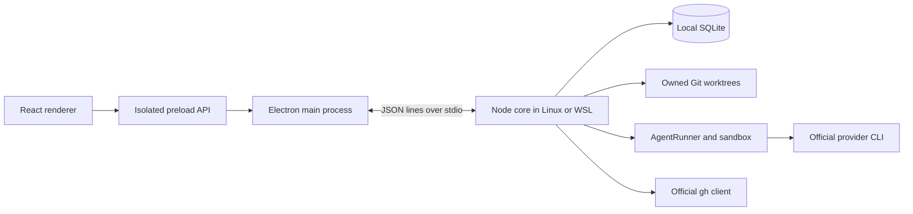
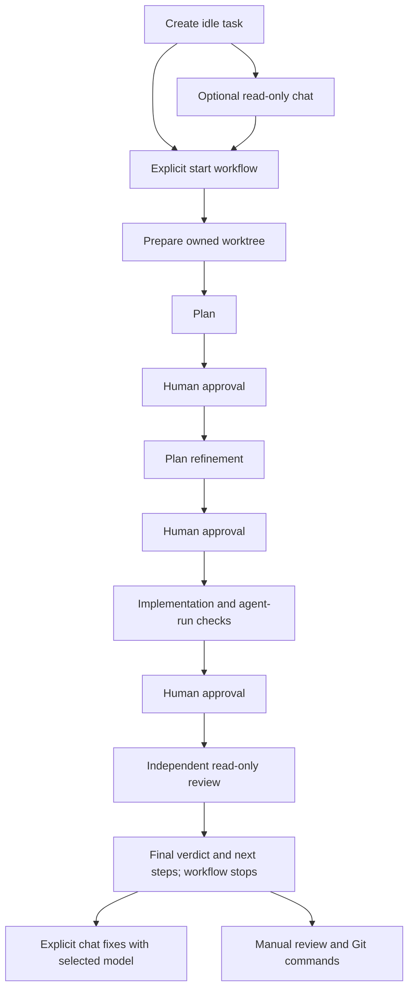

# Architecture

Akkco Vibestar is a local Electron workspace for issue contributions, PR analysis,
isolated repairs and manual issue discovery. Its architecture separates presentation
from the host authority that owns processes, files, Git and saved state.

Read [development](docs/development.md), [testing](docs/testing.md),
[security](docs/security.md) and [workflow contracts](docs/architecture/workflows.md)
for operational details. The [restructuring record](docs/architecture/restructuring.md)
tracks this repository preparation milestone.

## Runtime boundaries

The renderer has no Node integration. Context isolation, Chromium sandboxing,
main-frame sender validation and restrictive navigation/window policies apply in
Electron. The preload exposes typed RPC, events, desktop configuration and window
controls. Repository content is rendered as text or safe Markdown without raw HTML.

`electron/bridge.ts` owns core startup, request correlation, events and compatibility
negotiation. Linux starts Node directly. Native Windows uses argv-safe WSL execution
with a constant launcher and structured configuration. There is no application HTTP
server or external database.

`backend/main.ts` validates the newline-delimited transport envelope. `core.info`
advertises protocol/build capabilities; the bridge blocks unsupported mutations
against older helpers while preserving available reads and cancellation.

## Core composition and RPC

`backend/rpc.ts` constructs the existing domain services and owns their shutdown.
An explicit method registry delegates to `backend/rpc/` handlers for tasks,
repositories, storage, terminals, repair, review, PR analysis, output and system
operations. Issue Watch retains its own service dispatcher.

Handlers keep runtime Zod validation, confirmation literals and owner checks next
to the operation they authorize. A transport UUID is correlation, not permission.
Unknown methods fail explicitly. No renderer-supplied executor, transport, arbitrary
hook command or test provider can cross this boundary.

Canonical persisted/domain contracts remain in `backend/domain.ts` and each domain's
`contracts.ts`. Zod-derived types are preferred at validated boundaries. Renderer
projections reference those contracts through type-only imports and retain sparse
historical fields where required. Security canonicalizers stay in trusted backend modules.

## Execution engine

`backend/execution/engine.ts` is the stable façade and startup/shutdown coordinator.
Its internal collaborators are grouped under `backend/execution/engine/`:

| Module            | Responsibility                                                          |
| ----------------- | ----------------------------------------------------------------------- |
| `state.ts`        | One authoritative set of execution slots, leases and cancellation state |
| `scheduling.ts`   | Queue draining, active runs, terminal leases and maintenance exclusion  |
| `tasks.ts`        | Idempotent issue-task creation, request digests and initial persistence |
| `repositories.ts` | Registration, clone preparation, verified local connections and remotes |
| `workflow.ts`     | Explicit startup, task conversations, preparation and stage sequence    |
| `approvals.ts`    | Review gates, retries, draft recovery and explicit follow-ups           |
| `verification.ts` | Evidence rechecks, policy transitions and content-bound gap review      |
| `commands.ts`     | Sandboxed manual argv execution and observed command records            |
| `agents.ts`       | Existing runner coordination for utility and repair work                |

Collaborators share state rather than keeping independent concurrency counters.
They receive only the Engine methods and internal capabilities they need. Their
imports of Engine contracts are type-only; the façade remains the composition root.
Repository operations and workflow startup settle before shutdown closes SQLite.

`execution/agents` owns AgentRunner, prompts, continuations, streamed plans and UtilityAI.
`execution/providers` adapts official Codex and Antigravity CLI capabilities and output.
Ordinary Codex conversation uses app-server initialization, thread and turn messages
inside the mandatory outer sandbox. Completed conversations can resume their saved
thread for the same task, model and effort; interrupted turns are never replayed.
Each explicit turn owns its process and closes stdin on completion. The sandbox masks
user and project Codex configuration for this path while authentication and thread storage remain
CLI-owned. Successful official discovery is reused for up to 30 seconds; explicit
provider refresh and failed runs invalidate that cache. Workflow stages keep bounded
CLI/schema invocations and independent approval authority. App-server streaming items
normalize to the existing persisted event contracts. Antigravity continues an explicitly
identified completed conversation through its documented `--conversation` CLI option.
Antigravity sends one JSON user message through the documented streamed stdin protocol
and reads its schema from the mounted artifact file, keeping large issue context out of
process argv. The runner closes stdin after that message, completing one authorized turn.
Conversation turns use ordinary provider prose without an output schema. New sessions
receive project context and bounded completed history once; resumed turns receive only
the new user message. Workflow schemas and instructions remain exclusive to workflow runs.
`execution/runtime` owns process execution and the outer sandbox. `execution/output`
owns bounded output, streaming redaction and reported usage. `execution/terminals`
separates ephemeral login PTYs from owned task/repair shells. `execution/verification`
owns command evidence, policy, recovery and browser capability diagnostics.

## Issue tasks and approval flow

Creation persists `not_started`; it starts no provider or worktree preparation.
Explicit startup binds request identity, provider settings and selected completed
conversation messages or a reviewed summary. Historical authorized queue entries
keep their saved semantics. Idle chat uses a read-only stage-1 sandbox and never
creates a plan artifact or advances pipeline authority.
Complete greetings, thanks and app-identity questions use an empty managed conversation workspace, so they
skip cloning, worktree setup and source fingerprinting while retaining real provider
inference, task-owned history, usage and execution slots. New sessions identify Akkco
Vibestar as the host app. Repository questions use the owned worktree. Provider threads
are reused only within the same workspace scope and read/write authority, determined
from host-owned task state and saved user-message records.

The first planner receives the complete issue/comments and the scoped user brief; refinement
receives that brief and the original plan. Implementation receives the refined plan directly,
plus explicitly delivered user instructions when present. These are provider user messages,
also rendered as user turns in chat. Schemas still validate each stage's saved artifact. Long
user turns have a bounded preview with Show more/less. Thinking activity uses a
disclosure during execution; completed turns show Worked for with the final reply
outside the disclosure. Scrolled history exposes an explicit jump-to-latest control.

Each stage saves its own provider, model, effort and timeout. Codex and Antigravity
can fill any role; sandbox permissions follow the stage, independently of the chosen
provider. PR repair uses the saved implementation and review providers. Changing a
future stage starts no process and cannot rewrite a completed run. Legacy settings
and stage/gate identifiers retain their historical defaults and persisted spelling.
The bridge requires the per-stage-provider capability before workflow mutations.

Plans and implementation results pause durably. Feedback, retries and recovered
drafts retain their original stage boundaries. A saved pending instruction requires
an explicit inclusion decision. Cancellation and restart preserve evidence and do
not imply permission to rerun a provider. Final review ends at stage 6 with its fingerprint
and verdict; queued feedback becomes saved instructions and never restarts implementation.
Verified changes become ready for manual completion; findings or evidence gaps remain
`reviewed_with_gaps`. Historical final-acceptance gates remain readable and actionable.
After review, an explicit chat turn uses stage-3 workspace permissions and the selected
composer model, with the previous plan/results available as context. It creates no workflow
artifact and schedules no subsequent stage. Actual edits, including edits from a failed
turn, invalidate review authority. Manual task completion still requires current verified content.
The request carries explicit workspace access in its chat configuration; older callers retain
read-only semantics. The bridge requires the core's `workspace_chat: 1` capability before
forwarding an edit-capable chat request.

## Workspaces and filesystem ownership

`backend/workspace` owns Git operations, registered/imported sources, physical paths,
worktree identity, runtime mounts and editor launch. Each task pins its base branch
and commit and receives a dedicated owned branch. An explicitly started workflow can
use the registered source checkout when it is clean, on the configured base branch,
at the fetched base commit, and unreserved. Other tasks use separate worktrees;
dirty or busy source files are never committed, stashed or switched for another task.
Read-only pre-workflow chat and historical queued tasks retain isolated worktrees.
Repair assignments
reuse the physical contract without pretending to be issue tasks.

Managed paths are checked against the canonical startup root with no-follow parent
inspection. Category/repository/worktree aliases, unknown ownership and replaced
roots fail closed. Imported source checkouts are a separate explicit boundary.
Common-directory locks and branch/workspace/destination leases serialize writers.
Creation/removal checkpoints include process-start identity for crash recovery.

Agents see only their assigned source/runtime boundary. Ignored source
dependencies, including nested package directories, and recognized toolchains can be
mounted read-only; they are not copied or installed automatically. Nested mounts require
canonical directories and ignored/untracked dependency contents. Isolated worktrees also
require an empty owned destination; source assignments bind their installed dependencies
read-only in place. Aliases and tracked dependencies are never overlaid.
Refined plans carry dependency/browser/toolchain prerequisites into implementation.
Sandbox package runners default to offline npm and no-index pip operation.
Read-only planning/review cannot modify source or Git.
Source assignments persist an explicit mode, canonical registered path, common-directory
checkpoint and task/branch owner markers. Every use verifies that identity. Their provider
sandbox mounts Git metadata and recognized installed dependencies read-only even during
implementation. The source reservation survives pauses and restart; reuse requires a
known completed, cancelled or preserved owner with no active operation, and a clean
checkout manually returned to the base branch. Task cleanup never removes or resets a
source checkout; the existing history-only action preserves its files and branch. Managed
source assignments migrate with their repository; imported assignments retain the existing
requirement to keep their original storage location.
External editors and explicit manual terminals operate under the user's own environment.

Repository discovery searches configured project folders and known imported sources.
Home scanning is an explicit advanced option. Traversal skips temporary, generated,
dependency and managed trees; an explicit location can still name a legitimate
checkout under a temporary folder. Physical paths and Git common directories keep
managed task worktrees out of external-import candidates.
A read-only canonical-path lookup selects known registrations, including aliases,
before the external-import flow; it grants no import or execution capability.

## Persistence and recovery

`backend/storage/database.ts` owns SQLite with WAL, foreign keys and validated
migration transactions. Opening an older database creates a private asynchronous
backup before applying pending migrations. Existing migrations are retained unchanged.

`storage/records.ts` quarantines invalid collection records with payload-free
diagnostics and preserves original bytes. Exact owner reads refuse corrupt authority
records. Display fallbacks cannot become executable settings or invented ownership.
Task request tombstones prevent retries from recreating deleted history.

Root migration uses checked paths, a SQLite backup and a staged promotion journal.
Imported live worktrees are not silently relocated. Task disposal verifies ownership,
content and expected branch SHA. Ordinary cleanup protects dirty, ignored, hidden-index
and unpublished work. Deliberate discard requires a fresh preview and explicit loss
acknowledgment. History-only removal preserves an archived ownership record.

## Verification and review

Observed host/provider command records, provider-reported tests and environmental
prerequisites retain separate provenance. A model claim does not prove a check passed.
Unknown exits, skipped commands and missing evidence remain unverified.

Verification recovery can recheck saved evidence, run supported recorded argv, or
perform one explicitly authorized iteration with the saved implementation provider. It does not silently
install tools or reinterpret shell programs. Browser capability diagnostics are
separate from application-check results and require explicit selection/execution.

Implementation runs the required tests, lint, formatting and project-specific platform or
stress checks. Its result pauses for approval directly before independent review; there is
no separate validation stage or prerequisite checklist blocking that approval. Review runs
the applicable checks independently and receives unresolved implementation evidence.
Missing checks remain unverified, real test failures prevent final acceptance, and code
approved with gaps retains incomplete verification. Historical requirements and failures
survive later attempts. Legacy stage-4 tasks can enter implementation approval explicitly
without replaying implementation. Saved stage IDs and recovery RPCs remain compatible.

Codex implementation commands have network access for test servers within the mandatory
filesystem sandbox; it does not authorize dependency installation. Planning and review retain their
read-only provider mode and source/Git mounts; unavailable independent checks remain visible.

## GitHub, PR analysis and repair

`backend/github` uses official `gh` authentication and bounded API reads. Repository
metadata and authored PR discovery are independent of local clones. Refresh is explicit;
search absence never proves closure. Partial retrieval preserves prior complete state.
The PR inbox refresh calls `github.pullRequests.refresh`: GraphQL search includes lifecycle,
head and title metadata for up to 100 PRs per page, with batched identity lookups for
known PRs absent from search. It skips the repository catalog and has a 30-second
overall deadline. Repository catalog sync remains a separate action. Metadata observation
timestamps keep older analysis snapshots from overriding freshly observed lifecycle.

`backend/review/pr/watch.ts` owns the lightweight, once-per-app-launch PR attention
check and explicit **Recheck open PRs**. The app calls the capability-negotiated watch
endpoint once after startup; renderer remounts/focus are deduplicated by the core.
It refreshes metadata, reads up to four PR conversations concurrently through GraphQL,
and retrieves PR bodies, review requests, comments/threads and linked issue bodies.
Reviewer assignments and unresolved thread markers alone do not mean the viewer owes
work. Complete conversations are checked for unanswered requests and later follow-ups;
substantive author replies can mean waiting for the reviewer even if an older formal
changes-requested decision remains. The authenticated viewer's own requests are excluded.
Conversations share a compact classification
prompt, using the saved review model or utility fallback. No diffs, commits, CI history
or filesystem tool turns are requested. Large/incomplete data stays uncertain; it cannot
become a clear result. Source IDs are validated, unchanged successful results are reused,
and Stop aborts concurrent reads and inference without automatic retries. The latest
bounded watch state is stored through the existing settings/record-recovery boundary;
run prompts, reported usage and redacted logs use the existing UtilityAI runner and slots.
Interrupted/cancelled/failed watches require explicit recheck instead of startup replay.

`backend/scheduled` remains the legacy-named coordinator for explicit engineering
analysis. `backend/review/pr/analysis.ts` owns complete-context reports, source-linked
observations and report reuse for repair preparation. Opening a report, filtering or
refreshing metadata does not start detailed analysis. Legacy batch history remains readable.
Detailed analysis includes source packets and coverage validation; moderate contexts are
supplied directly and large contexts remain in complete packets. Both quick watch and
explicit analysis honor the saved model timeout and temporary picker overrides.

`backend/review/repair` owns immutable PR identity, selected observations, isolated
head/base preparation, upstream integration and conflict recovery.
Implementation followed by independent read-only review stops at manual
review. Users commit and push manually in the built-in terminal.
Repair history, usage, commands and three diff baselines remain distinguishable.

## Issue Watch

`backend/issue-watch` owns strict criteria revisions, deterministic exclusions,
tracker/claim evidence, bounded collection, semantic screening and saved results.
Saving/opening a watch never scans. Each explicit scan/retry/continuation creates
its own durable attempt and reserves at most one semantic invocation.
Discovery reads one page of up to ten issues, ordered by creation time (newest or
oldest). Each saved attempt records its page/order/next page, and Next 10 explicitly
authorizes a new attempt. Earlier candidates are not fetched again. Successfully
checked batches accumulate saved results without advancing repository-wide coverage.
Search pages can shift as GitHub issues change; page history is not an atomic snapshot.
Issue Watch serializes its GitHub reads across watches and stops for a minimum
60-second cooldown after a rate-limit error, with no automatic retries. The host
caps each attempt at 80 requests, including tracker and PR evidence. A bounded
SQLite HTTP cache (migration 27, at most 20 MiB / 1,000 entries) stores response
bodies and ETags. Authenticated conditional gh requests must return 304 before any
cached body is reused; failed requests never authorize stale-cache fallback.
Clearing the application cache also clears these HTTP entries.

Partial/cancelled/interrupted attempts retain evidence without advancing the last
complete baseline. Missing coverage stays uncertain. A final metadata recheck
prevents stale provider conclusions from overriding host facts. Issue Watch uses
the existing GitHub client, AgentRunner, usage and output services without cloning.

## Manual terminals and Git

Task and PR repair workspaces expose an explicit built-in terminal backed by a PTY
in the Linux/WSL core. The core verifies worktree ownership before starting the user's
configured interactive shell in that worktree. Like an editor's integrated terminal,
this user-operated shell inherits the normal environment, Git configuration and CLI
authentication; it runs outside the agent sandbox. It can run Git hooks and arbitrary
commands with the user's own authority. Provider and manual verification commands
continue through the mandatory sandbox and restricted Git executor.

Showing Terminal starts and focuses the shell, taking the existing task or repair
lease; close the shell before running an agent in the same workspace. Repeated opens
share one session, and hiding the dock retains it. Sessions survive renderer
reattachment, use bounded redacted output and stop on core shutdown. Before startup,
the core adds a missing `origin` alias in managed clones using the registered fork URL
or upstream URL. Existing remotes and imported checkout configuration stay untouched.
The bridge negotiates manual terminal support separately from legacy sandboxed PTYs.

The application has no commit/push dialogs, selected-file finalization, publication
RPCs, presets or destination configuration workflow. Users stage, commit, configure
remotes and push through terminal commands. Historical SQLite migrations and Git
journals remain for restart safety and conservative storage protection; they never
replay operations or grant permission for a new write. Contributor Husky hooks remain
optional quality checks installed without overwriting existing private hook policies.

## Renderer and styles

`src/app` owns composition and navigation. `src/features` groups tasks, chat,
workflow, verification, repositories, pull requests/repair, Issue Watch,
providers, settings and usage. Task completion and repair review provide direct
access to the shared terminal dock for manual commands.

Issue Watch presents a saved-topic overview and dedicated results, with local sorting
across classifications. Its compact availability display downgrades provisional or
historical positive claims; opening and sorting remain read-only. Matching issues
appear by default, with exclusions accessible through All results.

Shared primitives live in `components/ui`; shared workspace and diff controls live
in `components/shared` and `components/diff`. Reusable hooks live in `src/hooks`;
feature hooks stay with their owners.

Task approval controls and check summaries live in the secondary workspace. Approval
opens that sidebar once and keeps its actions available while inspecting other tool tabs;
the conversation contains agent output and the composer. Expanded tool content aligns
with the tool heading, and repository rows separate identity, metadata and actions.
The task composer has one agent conversation, with no Ask/Work mode switch. Explicit
Send to workflow and workflow-panel controls authorize pipeline feedback and execution.

Task and PR repair share the chat surface, composer, optimistic-message reconciliation
and event timeline. Server echoes replace optimistic rows by identity; submission failures
restore the sent draft without replacing later typing. Scroll position and follow intent
are scoped to a workspace visit, with resize-driven following and an explicit Latest action.
Messages stay in natural document flow without viewport-sized spacers or top anchoring.
Workflow prompts appear as ordinary user messages; idle tasks show a short welcome.
Completed activity folds under an elapsed “Worked for…” disclosure with assistant replies
visible below it. Provider input echoes and diagnostic tool metadata stay out of chat;
raw logs retain the technical evidence. Preparation commands stay in workflow/run tools. Owner-scoped
message caches retain real deltas across the bounded detail window and recover missing
prefixes through existing paginated event reads, without starting providers. Changed-file summaries
belong to implementation turns; final review messages distinguish code approval from
observed verification and explain the remaining manual step. Historical stage 4 records,
validation recovery and their persisted identifiers remain supported.

`src/lib/api.ts` owns transport and error presentation. Display formatting lives in
`lib/format.ts`; chat event decoding and verification argv parsing live in their
features. Existing view-state, keyboard, focus, diff and usage helpers are reused.
The unmounted selected-code UI and its exclusive legacy styles were removed; backend
selected-code review contracts and history remain intact.

`src/styles/index.css` imports Tailwind and ordered CSS chapters. Base tokens,
fonts, controls, feature rules and later refinements preserve the original cascade,
focus, responsive, motion and reduced-motion behavior. Font URLs resolve to bundled
Geist assets; its OFL notice is copied from `public` into the production renderer.
Shared controlled pickers provide search, keyboard selection, viewport containment
and focus return. Neutral selection and focus tokens are independent of semantic
status colors. Provider/model marks use local licensed assets with functional fallbacks;
model vendor identity never replaces the identity of the actual connected CLI.

## Extension and verification discipline

Add provider integrations behind the existing provider contract. Add RPC methods
within their domain handler with strict runtime validation. Extend domain schemas
and persistence deliberately; do not widen preload capabilities for convenience.
Avoid generic frameworks, catch-all utilities and new barrels without a real boundary.

Prettier is authoritative. Named Vitest projects separate regular feature/unit,
integration, security, PTY, desktop and live suites. Routine CI starts no paid model
or real GitHub write. Production builds retain the renderer, Electron entries,
Node-native addons and locked WSL helper resources.
Packaging maps `dist-core/node_modules` explicitly because electron-builder excludes a
resource root's `node_modules` by default. Linux-built helper addons remain Node ABI binaries;
Windows hosts execute that helper inside WSL. The project license and third-party notice
are included alongside the bundled font notice. The helper build and WSL install payload
also retain the project MIT license. See testing for acceptance gates.
