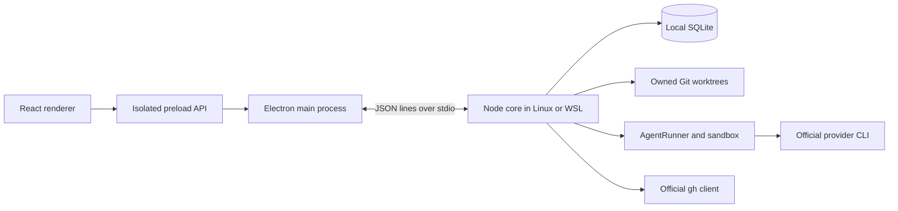
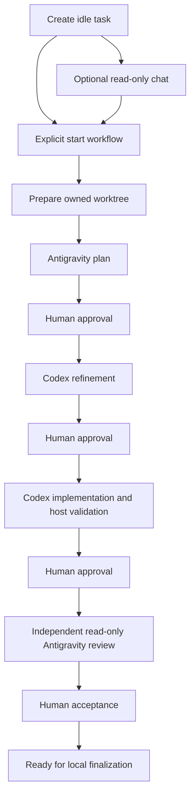

# Architecture

Akkco Vibestar is a local Electron workspace for issue contributions, PR analysis,
isolated repairs and manual issue discovery. Its architecture separates presentation
from the host authority that owns processes, files, Git and saved state.

Read [development](docs/development.md), [testing](docs/testing.md),
[security](docs/security.md) and [workflow contracts](docs/architecture/workflows.md)
for operational details. The [restructuring record](docs/architecture/restructuring.md)
tracks this repository preparation milestone.

## Runtime boundaries

The renderer has no Node integration. Context isolation, Chromium sandboxing,
main-frame sender validation and restrictive navigation/window policies apply in
Electron. The preload exposes typed RPC, events, desktop configuration and window
controls. Repository content is rendered as text or safe Markdown without raw HTML.

`electron/bridge.ts` owns core startup, request correlation, events and compatibility
negotiation. Linux starts Node directly. Native Windows uses argv-safe WSL execution
with a constant launcher and structured configuration. There is no application HTTP
server or external database.

`backend/main.ts` validates the newline-delimited transport envelope. `core.info`
advertises protocol/build capabilities; the bridge blocks unsupported mutations
against older helpers while preserving available reads and cancellation.

## Core composition and RPC

`backend/rpc.ts` constructs the existing domain services and owns their shutdown.
An explicit method registry delegates to `backend/rpc/` handlers for tasks,
repositories, storage, terminals, repair, review, PR analysis, output and system
operations. Git Finalization and Issue Watch retain their own service dispatchers.

Handlers keep runtime Zod validation, confirmation literals and owner checks next
to the operation they authorize. A transport UUID is correlation, not permission.
Unknown methods fail explicitly. No renderer-supplied executor, transport, arbitrary
hook command or test provider can cross this boundary.

Canonical persisted/domain contracts remain in `backend/domain.ts` and each domain's
`contracts.ts`. Zod-derived types are preferred at validated boundaries. Renderer
projections reference those contracts through type-only imports and retain sparse
historical fields where required. Security canonicalizers stay in trusted backend modules.

## Execution engine

`backend/execution/engine.ts` is the stable façade and startup/shutdown coordinator.
Its internal collaborators are grouped under `backend/execution/engine/`:

| Module            | Responsibility                                                           |
| ----------------- | ------------------------------------------------------------------------ |
| `state.ts`        | One authoritative set of execution slots, leases and cancellation state  |
| `scheduling.ts`   | Queue draining, active runs, terminal leases and maintenance exclusion   |
| `tasks.ts`        | Idempotent issue-task creation, request digests and initial persistence  |
| `repositories.ts` | Registration, clone preparation, verified local connections and remotes  |
| `workflow.ts`     | Explicit startup, read-only conversation, preparation and stage sequence |
| `approvals.ts`    | Review gates, retries, draft recovery and explicit follow-ups            |
| `verification.ts` | Evidence rechecks, policy transitions and content-bound gap review       |
| `commands.ts`     | Sandboxed manual argv execution and observed command records             |
| `agents.ts`       | Existing runner coordination for utility, repair and finalization work   |

Collaborators share state rather than keeping independent concurrency counters.
They receive only the Engine methods and internal capabilities they need. Their
imports of Engine contracts are type-only; the façade remains the composition root.
Repository operations and workflow startup settle before shutdown closes SQLite.

`execution/agents` owns AgentRunner, prompts, continuations, streamed plans and UtilityAI.
`execution/providers` adapts official Codex and Antigravity CLI capabilities and output.
`execution/runtime` owns process execution and the outer sandbox. `execution/output`
owns bounded output, streaming redaction and reported usage. `execution/terminals`
separates ephemeral login PTYs from owned task/repair shells. `execution/verification`
owns command evidence, policy, recovery and browser capability diagnostics.

## Issue tasks and approval flow

Creation persists `not_started`; it starts no provider or worktree preparation.
Explicit startup binds request identity, provider settings and selected completed
conversation messages or a reviewed summary. Historical authorized queue entries
keep their saved semantics. Idle chat uses a read-only stage-1 sandbox and never
creates a plan artifact or advances pipeline authority.

Plans and implementation results pause durably. Feedback, retries and recovered
drafts retain their original stage boundaries. A saved pending instruction requires
an explicit inclusion decision. Cancellation and restart preserve evidence and do
not imply permission to rerun a provider. Final acceptance binds the reviewed
worktree fingerprint; later edits require a fresh review.

## Workspaces and filesystem ownership

`backend/workspace` owns Git operations, registered/imported sources, physical paths,
worktree identity, runtime mounts and editor launch. Each task pins its base branch
and commit and receives a separate worktree and owned branch. Repair assignments
reuse the physical contract without pretending to be issue tasks.

Managed paths are checked against the canonical startup root with no-follow parent
inspection. Category/repository/worktree aliases, unknown ownership and replaced
roots fail closed. Imported source checkouts are a separate explicit boundary.
Common-directory locks and branch/workspace/destination leases serialize writers.
Creation/removal checkpoints include process-start identity for crash recovery.

Agents and terminals see only their assigned source/runtime boundary. Ignored source
dependencies and recognized toolchains can be mounted read-only; they are not copied
or installed automatically. Read-only planning/review cannot modify source or Git.
External editors operate under the user's own environment and do not share sandbox mounts.

Repository discovery searches configured project folders and known imported sources.
Home scanning is an explicit advanced option. Traversal skips temporary, generated,
dependency and managed trees; an explicit location can still name a legitimate
checkout under a temporary folder. Physical paths and Git common directories keep
managed task worktrees out of external-import candidates.
A read-only canonical-path lookup selects known registrations, including aliases,
before the external-import flow; it grants no import or execution capability.

## Persistence and recovery

`backend/storage/database.ts` owns SQLite with WAL, foreign keys and validated
migration transactions. Opening an older database creates a private asynchronous
backup before applying pending migrations. Existing migrations are retained unchanged.

`storage/records.ts` quarantines invalid collection records with payload-free
diagnostics and preserves original bytes. Exact owner reads refuse corrupt authority
records. Display fallbacks cannot become executable settings or invented ownership.
Task request tombstones prevent retries from recreating deleted history.

Root migration uses checked paths, a SQLite backup and a staged promotion journal.
Imported live worktrees are not silently relocated. Task disposal verifies ownership,
content and expected branch SHA. Ordinary cleanup protects dirty, ignored, hidden-index
and unpublished work. Deliberate discard requires a fresh preview and explicit loss
acknowledgment. History-only removal preserves an archived ownership record.

## Verification and review

Observed host/provider command records, provider-reported tests and environmental
prerequisites retain separate provenance. A model claim does not prove a check passed.
Unknown exits, skipped commands and missing evidence remain unverified.

Verification recovery can recheck saved evidence, run supported recorded argv, or
perform one explicitly authorized Codex repair iteration. It does not silently
install tools or reinterpret shell programs. Browser capability diagnostics are
separate from application-check results and require explicit selection/execution.

Environmental gaps can reach independent review only through a content/evidence-bound
acknowledgment. Genuine application failures cannot use that route. Code approved
with gaps remains local and cannot satisfy Git publication requirements. Historical
required checks and unresolved failures survive later implementation attempts.

## GitHub, PR analysis and repair

`backend/github` uses official `gh` authentication and bounded API reads. Repository
metadata and authored PR discovery are independent of local clones. Refresh is explicit;
search absence never proves closure. Partial retrieval preserves prior complete state.

`backend/scheduled` is a legacy-named manual coordinator, not an inference timer.
`backend/review/pr` owns complete-context analysis, source-linked observations,
report reuse and bounded explicit batches. Opening/tracking/refreshing a PR starts
no analysis. Reused/deterministic reports consume no semantic invocation.

`backend/review/repair` owns immutable PR identity, selected observations, isolated
head/base preparation, upstream integration, conflict recovery and publication.
Codex implementation followed by independent Antigravity review stops at manual
review. Local commit and remote publication remain separate explicit operations.
Repair history, usage, commands and three diff baselines remain distinguishable.

## Issue Watch

`backend/issue-watch` owns strict criteria revisions, deterministic exclusions,
tracker/claim evidence, bounded collection, semantic screening and saved results.
Saving/opening a watch never scans. Each explicit scan/retry/continuation creates
its own durable attempt and reserves at most one semantic invocation.

Partial/cancelled/interrupted attempts retain evidence without advancing the last
complete baseline. Missing coverage stays uncertain. A final metadata recheck
prevents stale provider conclusions from overriding host facts. Issue Watch uses
the existing GitHub client, AgentRunner, usage and output services without cloning.

## Git finalization and publication

`backend/finalization` owns selected literal paths, isolated preview worktrees/indexes,
content review, exact local commit objects, presets, journals and reconciliation.
Optional hook validation/execution lives in `finalization/hooks.ts`; mandatory host authorization remains in the service and independent publisher.
Unrelated source/task index entries survive. Subsets or changed content require a
fresh review; ignored/unsafe/credential-bearing content remains unselectable.

Publication separately verifies source repository or contribution-fork identity, current permission,
review fingerprint, required verification, exact destination/ref and remote SHA.
`backend/workspace/publication.ts` independently proves immutable fast-forward
ancestry and applies an exact compare-and-swap ref lease. Direct source publication
requires fresh authenticated write permission; other destinations must prove their
fork relationship. Non-fast-forward publication is refused. Ambiguous network outcomes
require read-only reconciliation. A strictly validated destination preflight is read-only;
combined commit/push still calls the existing approval, commit, prepare and publish guards.

Managed destination configuration verifies current GitHub identity, write permission
and source/fork relationship before changing local remotes under repository and task
leases. The bridge negotiates this mutation separately. Imported checkouts instead
select existing verified remotes; configuration never authorizes publication.

Contributor Husky hooks are optional quality checks. Their installer preserves
existing hook policies, refuses linked hook directories and skips linked worktrees. Application hooks run only through
the existing sandboxed policy; skipping them never skips mandatory host authorization.

## Renderer and styles

`src/app` owns composition and navigation. `src/features` groups tasks, chat,
workflow, verification, repositories, pull requests/repair, Issue Watch, finalization,
providers, settings and usage. Git Changes uses a task-local controller hook and
separate views for selected-file review and commit/push operations. Review is
accessible from Changes; the shared controller preserves literal path selection
between views. Existing core review and publication guards remain authoritative.

Issue Watch presents a saved-topic overview and dedicated results, with local sorting
across classifications. Its compact availability display downgrades provisional or
historical positive claims; opening and sorting remain read-only. Matching issues
appear by default, with exclusions accessible through All results.

Shared primitives live in `components/ui`; shared workspace and diff controls live
in `components/shared` and `components/diff`. Reusable hooks live in `src/hooks`;
feature hooks stay with their owners.

`src/lib/api.ts` owns transport and error presentation. Display formatting lives in
`lib/format.ts`; chat event decoding and verification argv parsing live in their
features. Existing view-state, keyboard, focus, diff and usage helpers are reused.
The unmounted selected-code UI and its exclusive legacy styles were removed; backend
selected-code review contracts and history remain intact.

`src/styles/index.css` imports Tailwind and ordered CSS chapters. Base tokens,
fonts, controls, feature rules and later refinements preserve the original cascade,
focus, responsive, motion and reduced-motion behavior. Font URLs resolve to bundled
Geist assets; its OFL notice is copied from `public` into the production renderer.
Shared controlled pickers provide search, keyboard selection, viewport containment
and focus return. Neutral selection and focus tokens are independent of semantic
status colors. Provider/model marks use local licensed assets with functional fallbacks;
model vendor identity never replaces the identity of the actual connected CLI.

## Extension and verification discipline

Add provider integrations behind the existing provider contract. Add RPC methods
within their domain handler with strict runtime validation. Extend domain schemas
and persistence deliberately; do not widen preload capabilities for convenience.
Avoid generic frameworks, catch-all utilities and new barrels without a real boundary.

Prettier is authoritative. Named Vitest projects separate regular feature/unit,
integration, security, PTY, desktop and live suites. Routine CI starts no paid model
or real GitHub write. Production builds retain the renderer, Electron entries,
Node-native addons and locked WSL helper resources.
Packaging maps `dist-core/node_modules` explicitly because electron-builder excludes a
resource root's `node_modules` by default. Linux-built helper addons remain Node ABI binaries;
Windows hosts execute that helper inside WSL. The project license and third-party notice
are included alongside the bundled font notice. The helper build and WSL install payload
also retain the project MIT license. See testing for acceptance gates.
