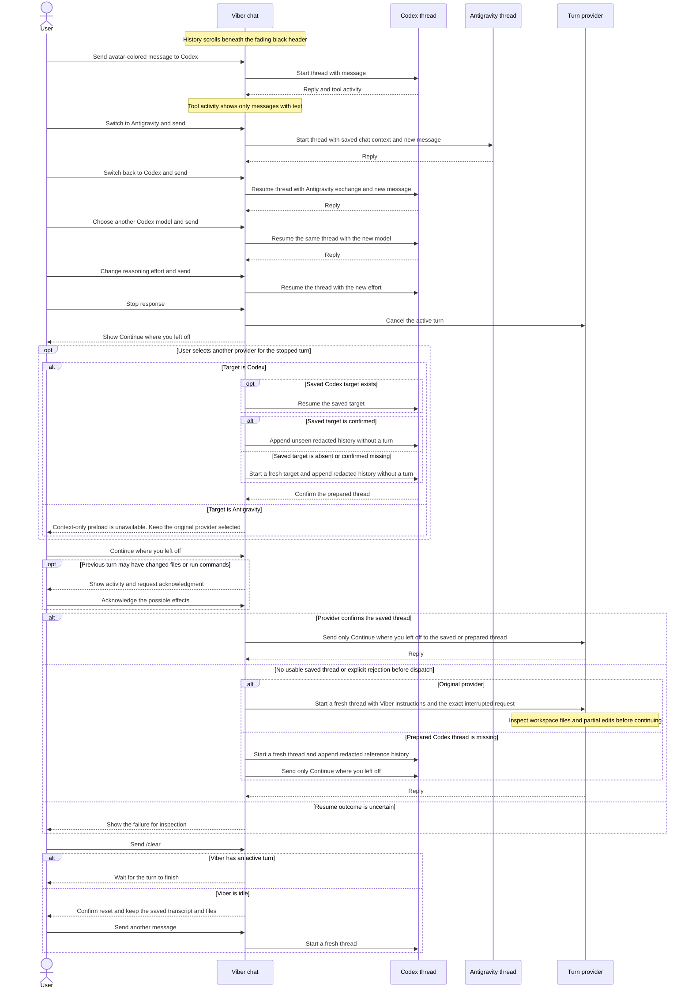
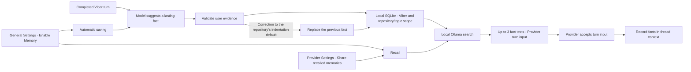

```mermaid
sequenceDiagram
    actor Human as Human Operator
    participant Title as TitleBar
    participant Panel as Viber Computer Panel
    participant Core as Core Computer Service
    participant Term as Isolated Terminal (xterm/PTY)
    participant Browser as Local Browser View (Human Takeover)
    participant Docker as Viber Runtime (Docker / Workspace)

    Human->>Title: Click Monitor icon
    Title->>Panel: Open selected Viber Computer panel
    Panel->>Core: computer.status (profile_id)
    Core-->>Panel: Return status (stopped / ready / running / error)
    Human->>Panel: Click Start
    Panel->>Core: computer.control (action: start)
    Core->>Docker: Ensure isolated container & home volume
    Docker-->>Core: Running
    Core-->>Panel: computer.changed (status: ready)
    opt Interactive Terminal
        Human->>Panel: Open shell or Provider Login
        Panel->>Core: computer.terminal.open
        Core->>Term: Spawn PTY in Viber workspace
        Term-->>Human: Interactive shell with bounded stream redaction
    end
    opt Human Sign-In & Local Service Takeover
        Human->>Panel: Select Browser tab
        Human->>Browser: Enter local service URL (http://127.0.0.1:3000)
        Note over Browser: Enforce local-only destination; agent browsing disabled
        Browser-->>Human: Interactive local web app view & sign-in takeover
    end
    Human->>Panel: Click Stop
    Panel->>Core: computer.control (action: stop)
    Core->>Docker: Stop container & close terminal
    Core-->>Panel: computer.changed (status: stopped)
```
