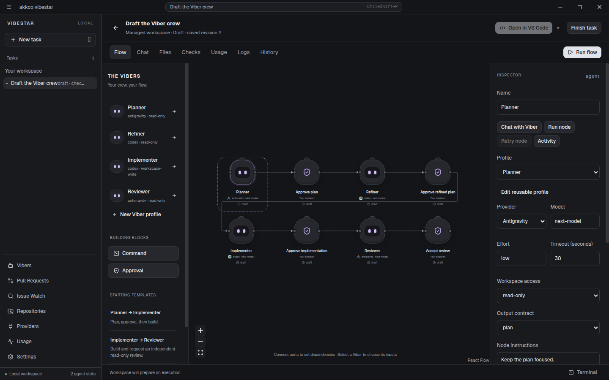

# Akkco Vibestar

Vibestar is a local desktop workspace for open-source contributions and pull-request repairs. It
combines reusable Viber profiles, editable task flows, isolated workspaces and recorded verification
evidence. It does not commit or publish work for you.

## Features

- Build a task around one Viber or connect several Vibers in an editable graph.
- Keep conversations, instructions and selected context with each task instance.
- Run commands and approval nodes with explicit workspace permissions.
- Inspect files, output, commands, checks and usage before deciding what to do next.
- Review pull requests, run explicit analysis and repair changes in isolated worktrees.
- Discover GitHub issues with manually started, bounded Issue Watch scans.
- Use the built-in terminal for manual Git commands and commits.

## Screenshots



Also see the [compact task sidebar](docs/screenshots/sidebar.png),
[pull request inbox](docs/screenshots/pr-inbox.png), and
[repository picker](docs/screenshots/repositories.png).

## Supported platforms and requirements

Vibestar runs on a Linux desktop or on Windows with WSL2 and a Linux execution distribution. The
desktop and the execution core require Node.js 22.12 or newer and npm 10 or newer. You also need Git,
Bubblewrap with unprivileged namespaces, and the system libraries required by Electron. Python 3 and
a C/C++ toolchain are needed when native SQLite or PTY packages must be compiled.

Install the official `gh` and provider CLIs you plan to use in the execution environment, then sign
in through each tool's own login flow. Details for Linux and WSL setup are in
[Development](docs/development.md).

## Install and run

```bash
git clone https://github.com/akshajrawat/akkco-vibestar.git
cd akkco-vibestar
npm ci
npm run dev
```

Renderer edits use Vite hot reload. Backend and Electron edits rebuild and restart the desktop. To
build and open a local production version:

```bash
npm run build
npm start
```

## Basic use

Create tasks with the **+** beside the sidebar search field. Search loaded tasks by title, repository,
issue number or status; press Escape to clear. The sidebar lists tasks independently, with queued and
executing work in **Working**. Both sections collapse independently. The bottom icons open Vibers,
Pull Requests, Issues, Usage and Settings. Settings opens a centered configuration workspace over
the current task. Manage Repositories and Providers there, search categories, and save or reset shared
preferences from the header. Category changes retain drafts; closing with unsaved changes asks for
confirmation. Closing Settings returns to the same mounted workspace. Usage keeps its bottom icon.
Use `Ctrl+Shift+P` → **Go to Tasks** to return to the task overview.
Collapse the sidebar beside the Vibestar name or with `Ctrl+B`; use the workspace's small reopen
button to bring it back.

Connect a local repository or create a repository-free task. Choose a Viber or graph template, edit
the saved flow, and start it explicitly. Review each node's output and observed checks; approval and
task completion do not imply that verification passed. Use the task terminal when you are ready to
stage, commit or push changes yourself.

Opening the app performs one lightweight pull-request attention check. Detailed pull-request
analysis and Issue Watch scans require an explicit request. Routine checks use local fixtures and do
not require a provider account.

## Project status and documentation

Vibestar is pre-stable; this repository does not represent an official release. Start with
[Contributing](CONTRIBUTING.md) and [Architecture](ARCHITECTURE.md). The
[security guide](docs/security.md), [development setup](docs/development.md),
[testing guide](docs/testing.md), and [workflow contracts](docs/architecture/workflows.md) cover
maintainer details.

Project code is licensed under [MIT](LICENSE). Bundled fonts and other third-party material retain
their own terms; see [third-party notices](docs/third-party-notices.md).
