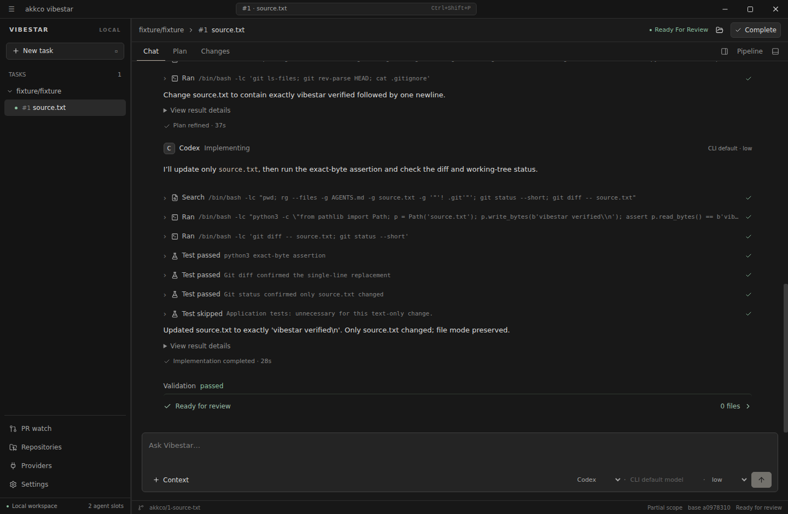

# Akkco Vibestar

A local desktop workspace for open-source contribution tasks and pull-request repairs.
Vibestar uses dedicated issue branches, isolated Git worktrees, official provider CLIs, per-stage provider choices, explicit review gates,
and recorded verification evidence. It does not automatically publish work.

This project is pre-stable. This repository preparation milestone is not an official release.



Screenshots use isolated fixture data.

More previews: [task overview](docs/screenshots/overview.png),
[PR inbox](docs/screenshots/pr-inbox.png), [repositories](docs/screenshots/repositories.png).

## What it does

- Creates idle issue tasks with optional read-only repository conversations.
- Keeps ordinary chat separate from workflow execution, with streamed answers,
  expandable tool activity and follow-up conversation in the same workspace.
  Codex uses its official app-server protocol; both providers can continue a completed
  conversation for the same task and model through their existing CLI sign-in.
  One agent conversation uses normal text replies; Send to workflow explicitly routes
  feedback into the pipeline.
- Runs an explicitly started Plan → Plan refinement → Implementation → Review
  workflow, with a provider choice for each stage and human approval between stages.
  Review ends with a verdict and next steps. Request further fixes directly in chat
  using the selected model; the workflow does not automatically repeat.
- Shows workflow prompts as user messages, agent replies in chat, and collapsible
  “Worked for…” activity. Basic app questions skip repository preparation.
- Keeps each task's pinned base, files, conversation, command evidence and usage separate.
  A clean, idle source checkout can hold the first workflow's issue branch. Overlapping
  tasks and dirty checkouts use separate worktrees without committing or stashing existing changes.
- Checks open PR conversations once when the app opens, flagging unanswered change
  requests from other people and distinguishing replies waiting on a reviewer.
  Conversations load concurrently and share a compact model check. Recheck open PRs
  runs another pass with optional model/time-limit overrides.
- Refresh PR List updates lifecycle metadata in bulk without running AI. Merged and closed
  history stay available through the status filter; detailed engineering analysis stays explicit.
- Saves Issue Watch topics in a full-width list. Open a topic for claim status,
  one-click GitHub links and search. Scan up to 10 newest or oldest issues at a time,
  then select Next 10. Saved batches and GitHub response caching reduce repeated
  retrieval; incomplete evidence stays uncertain.
- Provides a built-in terminal in task and PR repair workspaces for manual Git
  commands, commits and pushes using your normal Linux/WSL shell and authentication.
  Opening the terminal starts and focuses the shell in the task's worktree.
- Shows actual provider output, verification gaps and reported usage without inventing results.
- Implementation and independent review run the applicable tests, lint and formatting;
  sidebar approvals move between stages without a separate validation workflow.
- Agents reuse installed dependencies and toolchains; they report missing prerequisites
  instead of installing packages or browsers.

## Architecture

React runs in a sandboxed Electron renderer. A narrow preload bridge sends requests
and events to a Node execution core over standard input/output. Linux runs the core
directly; native Windows runs it inside WSL. SQLite stores local state.

The core owns processes, provider invocation, filesystem access, Git operations and
workspace ownership. See [ARCHITECTURE.md](ARCHITECTURE.md) for module ownership
and [the security guide](docs/security.md) for trust boundaries.

## Prerequisites

- Linux desktop, or Windows with WSL2 and a Linux execution distribution.
- Node.js 22.12 or newer and npm 10 or newer.
- Git, official `gh`, `codex` and `agy` CLIs in the execution environment.
- Bubblewrap with working unprivileged namespaces. Missing isolation blocks execution.
- Python 3 and a C/C++ build toolchain if native SQLite/PTY binaries need compilation.
- A graphical desktop and the system libraries required by Electron.

Authenticate provider CLIs through their official login flows. Routine tests use
fixtures and do not require provider subscriptions. Advanced Linux and Windows setup
is covered in [development](docs/development.md).

## Quick start

From your checkout:

```bash
cd ~/projects/akkco-vibestar
npm ci
npm run dev
```

Renderer changes use Vite HMR; backend and Electron changes rebuild and restart the
desktop. When launched from WSL, development selects native Windows Electron by
default while execution and provider accounts stay in WSL.

For a local production build:

```bash
npm run build
npm start
```

Use an isolated `VIBESTAR_HOME` when experimenting with task creation or cleanup.
Never point automated tests at your normal application state.

## Repository map

```text
backend/                 Node execution core and trusted domain services
  execution/             Engine, agents, providers, sandbox/runtime, PTYs and evidence
  github/                Official gh client and repository/PR discovery
  issue-watch/           Manual bounded discovery and saved scan history
  review/                File review, PR analysis and isolated repair workflows
  workspace/             Git, ownership, paths, runtimes and editor integration
  storage/               SQLite, migrations, backup and owned cleanup
  rpc/                   Domain request validation and dispatch
src/
  app/                   Application composition and desktop navigation
  features/              Feature-owned components, hooks and contracts
  components/            UI primitives and shared workspace/diff controls
  hooks/                 Reusable renderer hooks
  lib/                   Transport, display and shared view-state utilities
  styles/                Ordered CSS chapters, tokens and responsive rules
electron/                Desktop main process, preload and core transport
scripts/                 Development, build, platform and contributor tooling
tests/                   Unit, integration, security, PTY, desktop and domain tests
docs/                    Contributor guides, architecture contracts and evidence
```

## Development checks

```bash
npm run check            # Formatting, ESLint, TypeScript and unit/domain regression
npm run verify           # All deterministic suites plus production build
npm run test:integration
npm run test:security
npm run test:tui
```

`npm ci` installs optional contributor hooks when no existing hook policy would be
overwritten. Pre-commit formats/lints staged files and preserves unstaged hunks.
Pre-push runs `check` and the security suite. [Testing](docs/testing.md) explains
suite boundaries, desktop fixtures and opt-in tests. CI reports eight separate checks.

## Contributing

Start with [CONTRIBUTING.md](CONTRIBUTING.md), then read the relevant architecture
contracts before changing execution, persistence, ownership or Git code.
Changes should preserve saved data, explicit authorization and existing behavior.

Live-provider tests consume subscription allowance. Live GitHub fixtures can write
to a real repository. Neither belongs in routine verification without explicit authorization.

## License

Project code is available under the [MIT License](LICENSE).
Bundled Geist fonts retain their [SIL Open Font License](public/Geist-OFL.txt).
Dependencies and other third-party material retain their own licenses; see
[third-party notices](docs/third-party-notices.md).
