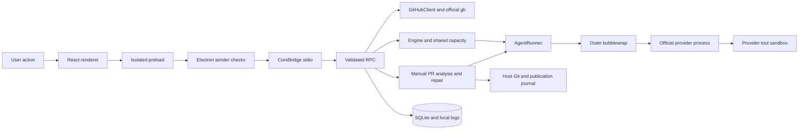
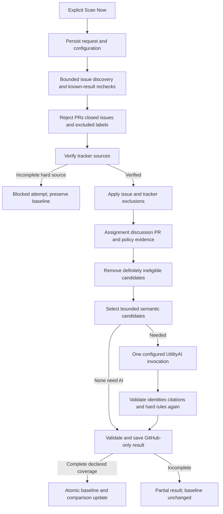
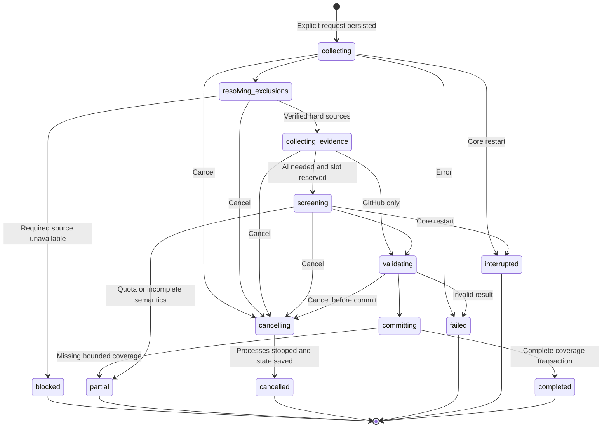

# Issue Watch: security audit and implementation plan

Status: **Approved; S1 and S2 verified; S3 semantic integration in progress. S4–S5 are not implemented yet.**

Verified source revision: `485f30d8c16bb566aab9c39ae9016d500ad2996c`.

Prepared October 20, 2026. The audit below describes the original source; its historical line references are not current patch locations. The implementation ledger records subsequent work and measured verification. The user approved the complete S1–S5 specification and recommended defaults in the attached implementation brief.

## Implementation ledger — October 20, 2026

The complete five-milestone goal remains active. S1 implementation, independent security reviews and full verification checkpoint passed. S2 backend implementation passed its fixture/full-suite checkpoint; S3 semantic integration is in progress; S4–S5 remain outstanding.

| Work               | Current evidence/status                                                                                                                                                                                                                                                                       |
| ------------------ | --------------------------------------------------------------------------------------------------------------------------------------------------------------------------------------------------------------------------------------------------------------------------------------------- |
| SEC-01/02 host Git | All direct production host Git callers use the shared built-in/config/transport boundary. Canonical HTTPS and fixed official gh delegation preserve authentication; unsupported executable config is refused before mutation. Publication retains its private hook and exact-SHA protections. |
| SEC-04 ownership   | Canonical managed parents, durable task creation/removal checkpoints, task-specific metadata owners, interrupted-operation reconciliation, non-force clean removal and expected-SHA branch deletion. Fixture source files/index and unrelated worktrees are preserved.                        |
| SEC-05 integrity   | Versioned issue-v2 authority binds exact HEAD/index and all tracked/untracked bytes/modes/links through shared async primitives. Raw metadata is never display-redacted or silently truncated. Pending legacy authority requires fresh review; completed history survives.                    |
| SEC-03 sandbox     | Empty-root explicit mount manifest, selected toolchain/runtime/provider state, private directory/socket canaries and worktree-relative executable compatibility. Official provider state/network remains a trusted boundary.                                                                  |
| SEC-06 execution   | Bounded stateful PTY redaction, byte/item output and disk backpressure limits, sink-failure cancellation, bounded discovery protocol and process-group settlement. Cancelled runs skip independent post-run allowance discovery.                                                              |
| SEC-07 persistence | Migration 21 diagnostics and JSON-safe index; strict exact reads and isolated collection rows; original bad bytes retained. Async pre-migration backups, transaction/FK rollback and released startup locks have fixtures. Shared UI schemas cover tasks/repositories/GitHub/jobs/analysis.   |
| COR-01 requests    | Durable canonical request digests, shared in-flight retrieval, transactional task reservation, history-removal tombstones and stable composer retry identities. Shutdown cancels pending retrieval and does not enqueue it on restart.                                                        |
| Narrow cleanup     | Removed proven test-only scheduled analysis/classification branches and unmounted Monaco diff components/dependencies. Kept supported selected-code APIs/history, Changes, Overview, inert scheduler guard and migration history. Tests now exercise active UtilityAI/PR analysis helpers.    |
| S3–S5              | S3 in progress; S4–S5 not started. Detailed approved schema, deterministic rule/compiler, dynamic tracker/evidence, semantic budget, UI and verification requirements below remain the specification.                                                                                         |

Baseline before behavior changes: unrestricted npm test passed **227 tests**, with 10 opt-in skipped (37 passing files). The initial restricted invocation failed 39 tests because nested child-process output was lost; an unchanged minimal Node spawn reproduced it. This was an environment failure, not a patch regression.

Intermediate verification includes the initial boundary checkpoint (**274 passed, 10 opt-in skipped**), subsequent security/cleanup/repair regressions (**120 passed in 13 files**), persistence/schema/idempotency regressions (**27 passed in 7 files**), schema-corruption renderer coverage (**5 passed**), composer transport retries (**5 passed**) and dead-code compatibility regressions (**35 passed in 5 files**). Typecheck passed after cleanup. These are intermediate measurements; fresh full S1/S5 results belong in the verification record. No live subscription inference, real credential reads, personal-source mutations or GitHub writes were performed.

Independent read-only investigation/review informed fixes for Git-native boolean parsing, older Git lazy-fetch behavior, NUL metadata framing, cleanup owner/race/removal-intent cases, ANSI redactor bounds, whitespace-separated credentials, relative executable resolution, auth-session lifecycle, corrupt command backfills and schema-invalid shared collections. Focused regressions cover each confirmed case. The fake fsmonitor marker executes under ordinary fixture Git and remains absent under the application's actual path. Guarded publication and reconciliation regressions remain active.

S1 checkpoint passed 316 tests, integration 7, PTY 3, lint/type/format/build. S2 adds migration 22, the six normalized tables and clone-independent GitHub identities, deterministic previews/ambiguity confirmation, structural Markdown tracker resolution, bounded issue/discussion/PR/policy collection, host claim rules, baseline comparisons, manual RPC lifecycle and helper capability negotiation. The fresh S2 full suite passed **344 tests with 10 opt-in skipped (54 passing files)**; typecheck and lint passed. The first S2 bridge fixture needed its expected snapshot updated for the new explicit capability. S2 build, root/nested-doc formatting and whitespace checks also passed. S3 now connects one reserved UtilityAI/AgentRunner invocation, migration 23 attribution/utility events, owner-checked logs/history and strict evidence validation. The focused watch suite has passed 38 tests, including actual sandboxed fixture processes, reported usage, quota failure, cancellation, changed final metadata and explicit continuation. Full S3 verification remains pending.

Next: connect at most one semantic UtilityAI invocation and run attribution, then complete S4 → S5 without another approval. Current [official Antigravity FAQ](https://www.antigravity.google/docs/faq/) explicitly excludes consumer-plan third-party application wrapping; new Issue Watch will expose Antigravity as unsupported and use supported Codex integration while preserving existing adapters. Provider-native tool/auth behavior remains unverified and is not presented as complete credential isolation.

## 1. Scope, evidence, and verified architecture inventory

### Audit method and limits

The working tree was clean when inspection began. Application source, dependencies, database migrations, and user data were not changed. Review traced callers from the renderer through Electron and RPC into execution, Git, persistence, and publication. Existing tests were read as evidence of intended contracts, not reported as newly passing.

Small disposable probes exercised the actual TypeScript implementations by bundling them in memory with the installed esbuild. They used temporary repositories, fake credential-shaped strings, inert marker scripts, and a loopback HTTP/socket fixture. Every temporary directory was removed. No provider inference, actual GitHub API mutation, real repository mutation, or credential inspection was performed. These were focused audit experiments, not a run of the application test suite.

An earlier Codex Security deep-scan coordinator was started. On continuation, its execution cell was gone and its tools were unavailable. No completed plugin report or canonical findings were recovered. **This is a direct source audit with focused runtime probes, not a completed plugin deep-scan report.** Plugin token measurements and independent worker coverage are unavailable. Findings here stand on the locations and experiments described below. Full live provider, installed Windows, keyring, and remote publication behavior remains unverified.

| Boundary                | Verified implementation and callers                                                                                                                                                   | Relevant contract                                                                                                                                                                                                                              |
| ----------------------- | ------------------------------------------------------------------------------------------------------------------------------------------------------------------------------------- | ---------------------------------------------------------------------------------------------------------------------------------------------------------------------------------------------------------------------------------------------- |
| Core startup            | `backend/main.ts:10–117`; `Engine.create/start` in `backend/execution/engine.ts:333–445`                                                                                              | Node core uses newline JSON over stdio; UUID transport request IDs; startup drains existing issue tasks. `core.info` advertises protocol 3, approvals, manual PR analysis, and PR repair.                                                      |
| Renderer authority      | `electron/preload.ts`, `electron/main.ts:102–183,202–210,353–360`, `src/lib/api.ts`                                                                                                   | Main-frame sender validation; context isolation; Chromium sandbox; no Node integration; navigation/windows/webviews denied. Renderer RPC dispatch is broad but backend methods validate their own inputs.                                      |
| Workspace shell         | `src/App.tsx:30–169`, `src/lib/types.ts`, `src/lib/useWorkspace.ts`                                                                                                                   | Tasks, PR watch, repositories, providers, settings. Local state refresh/event debounce does not itself fetch GitHub. `Overview` remains the active task landing component.                                                                     |
| Issue execution         | `backend/domain.ts`; `Engine.enqueue/createTask/drain/pipeline/approveStage`; `execution/prompt.ts`, `continuation.ts`, `streamed-plan.ts`                                            | Prepare → Antigravity planning → human gate → Codex refinement → human gate → implementation/validation → human gate → Antigravity review → human gate. `createTask` queues execution immediately.                                             |
| Shared provider runtime | `execution/utility-ai.ts:5–36`; `Engine.runUtility:1527–1600`; `AgentRunner.run:44–529`                                                                                               | Detached read-only analysis already works without a checkout. It shares engine capacity, cancellation, schema validation, provider discovery, redacted logs, and `ai_usage`. Detached runs currently do not persist normalized `agent_events`. |
| Official adapters       | `execution/providers/{contracts,codex,codex-models,codex-schema,antigravity}.ts`                                                                                                      | Codex invokes subscription login with read-only/workspace-write and no approvals; Antigravity uses plan/accept-edits plus sandbox. Model/effort validation and nullable reported usage already exist.                                          |
| Processes and terminals | `execution/{process,auth,task-terminals,command-executions,usage}.ts`                                                                                                                 | Argv execution without shell interpolation; filtered environment; process-group termination; saved PID/start identity; separate auth PTYs and task PTYs; observed commands distinguished from reported tests.                                  |
| GitHub reads            | `github/client.ts:4–171`, `github/service.ts`; `workspace/issue.ts`; `scheduled/github.ts`                                                                                            | Official `gh` authentication and GETs. Metadata catalog is independent of local clones. Generic bounded pagination exists. Issue-task context fetches full comments and up to 20 linked PR contexts; it is too expensive for broad discovery.  |
| PR analysis             | `scheduled/scheduler.ts`; `review/pr/{contracts,analysis,actions}.ts`; `src/components/{ScheduledPage,PrDetails}.tsx`                                                                 | Scheduler is now a manual coordinator. Startup normalizes legacy records; `tick` is inert; `scheduled.run` is GitHub-only; `scheduled.analyze` is explicit. Analysis validates quotations/source IDs and preserves reports.                    |
| Repair                  | `review/repair/{identity,contracts,store,workspace,service,prompt}.ts`                                                                                                                | Independent sessions/worktrees; immutable upstream/fork identity; exact fetched head/base; owned markers; conflict checkpoints; exclusive destination/branch leases; Codex implementation and Antigravity verification stop at manual review.  |
| Publication             | `review/repair/publication.ts:177–650`; `RepairService.approve/commit/publish/reconcilePublication`; repair dialogs                                                                   | Approval, content fingerprint, local commit, preview, separate confirmation, fresh identities, exact remote SHA, ancestry, non-force push with private pre-push guard, journal, read-only reconciliation. No startup push replay.              |
| Workspace identity      | `workspace/{git,paths,discovery,runtime,editors}.ts`                                                                                                                                  | Canonical common-directory locks; imported checkout registration; managed clones; worktree checks; path validation; read-only dependency/runtime mounts; approved editor executables.                                                          |
| Persistence             | `storage/{database,migrations,service,bootstrap,migrate-root,logs}.ts`                                                                                                                | better-sqlite3, WAL, foreign keys, 5-second busy timeout; migrations **1–20**; shared history/usage; root migration uses SQLite backup plus staging/promotion journal. Imported live worktrees cannot be silently migrated.                    |
| Output and review UI    | `TaskWorkspace`, `AgentTimeline`, `AgentResponse`, `CurrentRun`, `LogView`, `ChangesView`, repair components; `src/lib/agent-output/*`, `taskView`, `usage`, keyboard/focus utilities | Shared readable/raw output, scoped events/log paging, task/repair ownership checks, exact sent prompts, nullable usage, keyboard tabs/dialogs. Markdown uses react-markdown/remark-gfm without raw HTML.                                       |
| Visual system           | `src/styles.css`, `src/components/ui/button.tsx`, shared dialogs/resize controls                                                                                                      | Existing dense dark IDE surfaces, semantic colors, focus conventions, resizable panes. Extend these styles rather than introducing another UI system.                                                                                          |
| Verification            | `tests/*`, `tests/pr-repair/*`, `package.json`, `scripts/{build,dev,dev-host,test-windows}.mjs`                                                                                       | Unit/renderer tests, real isolated Git/PTY tests, opt-in Electron fixtures and packaging scripts. Historical results in `docs/VERIFICATION.md` are not current execution evidence.                                                             |

Documentation inspected: `README.md`, `ARCHITECTURE.md`, `docs/PR-REPAIR-SYSTEM.md`, `docs/VERIFICATION.md`, and `docs/IDE-HARNESS-PR-REVIEW-PLAN.md`. Inspection included actual import/RPC call searches across components and library code, focused reads of execution and permission-sensitive paths, migrations, and regression fixtures. It is not a claim that every rendering branch or every operating-system behavior was exercised.



## 2. Findings ranked by severity

No Critical finding is established. Severity measures likely consequences under the stated prerequisites; a locally configured executable is not described as something a remote issue comment can independently install.

Audit experiment receipts (temporary fixtures removed after execution):

| Probe                                                                 | Observed result                                        | What this establishes                                                          |
| --------------------------------------------------------------------- | ------------------------------------------------------ | ------------------------------------------------------------------------------ |
| Actual `GitWorkspace.diff` with fixture fsmonitor                     | `fsmonitorExecuted: true`                              | Host-side command execution during a read                                      |
| Actual repair Git wrapper with fixture merge driver                   | `hostDriverExecuted: true`                             | Hooks/fsmonitor overrides do not suppress custom merge drivers                 |
| Actual remote-head read with loopback rewrite/401                     | `unexpectedHostHelperExecuted: true`, operation failed | Helper execution precedes final identity/SHA rejection                         |
| Actual read-only detached outer sandbox                               | `outsideRead: true`, `hostLoopback: true`              | Outer filesystem/network boundary only; no provider-tool escape proved         |
| Actual layout/task-root checks with external worktrees symlink        | `acceptedExternalWorktree: true`                       | Escaping category root accepted                                                |
| Actual issue fingerprint with credential-shaped untracked path        | ENOENT                                                 | Display redaction corrupts an internal filename                                |
| Actual redactor applied to fake token halves                          | Whole token masked, split token reconstructed          | Stateless PTY chunk redaction is insufficient                                  |
| Tracked fake secret changed; separate 34,816,000-byte diff experiment | Equal issue hashes were **not** observed               | Counterevidence: these experiments do not establish an approval-hash collision |

| ID       | Severity | Classification                                                    | Finding                                                                                                                  |
| -------- | -------- | ----------------------------------------------------------------- | ------------------------------------------------------------------------------------------------------------------------ |
| SEC-01   | High     | Confirmed unsafe execution, reproduced                            | Host Git reads and repair merges can execute configured commands outside the agent sandbox.                              |
| SEC-02   | High     | Demonstrated transport/credential weakness                        | A confirmed GitHub URL can be rewritten before host fetch/read, invoking an unexpected credential helper.                |
| SEC-03   | High     | Demonstrated outer-boundary weakness; provider exploit unverified | Outer sandbox permits unrelated host reads and host-network access, and mounts provider state into the provider process. |
| SEC-04   | Medium   | Confirmed path-validation bug, reproduced                         | A symlinked managed worktrees root is accepted as an external boundary.                                                  |
| SEC-05   | Medium   | Confirmed fingerprint availability bug; broader integrity risk    | Issue fingerprinting consumes redacted, bounded Git output and fails on credential-shaped untracked filenames.           |
| SEC-06   | Medium   | Confirmed redaction weakness, reproduced                          | PTY chunk boundaries can reconstruct an unredacted token.                                                                |
| SEC-07   | Medium   | Confirmed failure path by inspection                              | Malformed persisted JSON can prevent global reads, recovery, or an older database upgrade.                               |
| COR-01   | Medium   | Confirmed contract gap by inspection                              | Regular issue creation has no durable request idempotency and can enqueue duplicate model pipelines.                     |
| MAINT-01 | Low      | Confirmed stale behavior/text                                     | `scheduled.fix` still says repair is a later milestone despite the implemented repair workflow.                          |
| MAINT-02 | Low      | Confirmed reachability/documentation inconsistency                | Test-only legacy analysis paths remain; current docs misdescribe some mounted UI components.                             |

### SEC-01 — executable host Git configuration

- **Locations:** `workspace/git.ts:91–115` clone/fetch; `git.ts:131–174` limited preparation overrides; `git.ts:442–545` diff/status/stats; `review/repair/workspace.ts:31–90,486–503,547–560`; `review/repair/publication.ts:113–159,254–288`; `storage/service.ts:113–278`; discovery/runtime and root-migration Git callers.
- **Observed:** `cleanEnvironment` removes inherited Git environment overrides, but normal Git still reads system/global/local configuration and conditional includes. Several wrappers disable hooks/fsmonitor, while ordinary `diff` calls execute a raw `status`. Merge, checkout, staging and commit can use configured merge drivers and clean/smudge/process filters. Signing is disabled on repair commits, not every possible Git command. Argv safety does not neutralize Git configuration.
- **Probe:** an isolated checkout with `core.fsmonitor=<temporary marker script>` executed that script during the actual `GitWorkspace.diff` call. An isolated diverged history with `.gitattributes` selecting `merge=fixture` and a configured marker driver executed that driver under the actual repair command wrapper, despite hooks/fsmonitor overrides.
- **Prerequisite/impact:** an imported or shared repository has executable configuration, or repository attributes select an already configured command. A repository file cannot define a Git config command by itself. Consequences are host-user command execution and access to credentials/source outside bubblewrap.
- **Smallest safe fix:** centralize host Git policy, apply it to every host caller, suppress executable config surfaces, and reject unsupported filter/merge configurations before mutating. Preserve necessary Git metadata and official authentication. See section 4 for the exact proposed policy and compatibility choice.
- **Regression:** fsmonitor, hooks, includes/includeIf, clean/smudge/process filters, custom merge drivers, signing, external diff/textconv, aliases, maintenance and environment-override fixtures. Assert no marker execution and unchanged source branch/index/files.
- **Migration/compatibility:** no destructive migration. Repositories needing external filters/drivers receive an actionable refusal until a supported trusted profile exists. This is a deliberate compatibility decision for approval.

### SEC-02 — rewritten transport and credential helpers

- **Locations:** `workspace/git.ts:91–130`; `review/repair/workspace.ts:93–119,333–345,429–442`; `publication.ts:502–519,571–597`; `domain.ts:315–342` URL parsing.
- **Observed:** validating a stored GitHub URL does not bind the URL Git ultimately contacts. The repair publication path checks `ls-remote --get-url` immediately before push, which is a useful defense, but clone/fetch/remote-head reads lack the same policy. Read URL resolution alone is not a full audit of push-only rewrites. Configured helpers can run before a later identity/SHA check rejects the operation.
- **Probe:** a local URL rewrite mapped a syntactically valid fixture GitHub URL to a loopback server returning HTTP 401. The actual `RepairWorkspaces.remoteHead` call executed a fake credential helper before failing. No real token or GitHub connection was used.
- **Impact:** unexpected host command execution and connections to a destination other than the intended repository; potential credential disclosure depends on the configured helper and protocol. **No successful unapproved publication was demonstrated.** The private pre-push destination guard is counterevidence against that broader claim.
- **Fix:** bind canonical identity to the effective read and push transport, suppress rewrites and arbitrary helpers in the execution profile, and inject only an approved official GitHub authentication mechanism. Keep the private advertised-SHA guard.
- **Regression:** `insteadOf`, `pushInsteadOf`, pushurl/multiple URLs, helper shell snippets, remote helpers, protocol changes, SSH command overrides, rewritten same-host/wrong-owner paths, and races after preview. All network fixtures use loopback or local bare repositories.
- **Compatibility:** ordinary `gh` authentication remains supported; SSH behavior needs the explicit default in section 20. No credentials enter SQLite or renderer contracts.

### SEC-03 — outer sandbox is not a complete read/network boundary

- **Locations:** `execution/sandbox.ts:46–98,100–153`; `process.ts:30–53`; provider invocations in `providers/codex.ts:74–114`, `providers/antigravity.ts:90–111`; `agent-runner.ts:250–280`.
- **Observed:** bubblewrap mounts `/` read-only, masks `/tmp`, `/home`, `/mnt`, and the data root, then exposes the workspace, runtime dependencies, and selected artifacts. It does not unshare the network. `/var`, `/srv`, `/opt`, and `/run` are not comprehensively hidden. Read-only socket paths do not inherently prevent socket connections. The selected provider's entire `~/.codex` or `~/.gemini` directory is mounted read-write; `~/.local/bin` is mounted read-only.
- **Probe:** a process in the actual detached read-only outer sandbox read an inert canary outside its data root under `/var/tmp` and connected to a loopback host server. This proves the outer boundary, **not** a Codex/Antigravity shell-tool escape.
- **Trust distinction:** the official provider process needs authentication and model-service connectivity. Provider-created subprocesses initially inherit the outer mounts; their additional restrictions depend on the provider's own tool sandbox. Provider file-reading tools are another boundary. No prompt can substitute for either control.
- **Impact:** repository/comment prompt injection may induce reads that the outer sandbox permits. Disclosure via model context, provider output, or an outbound tool depends on provider permissions/version. Exact live credential-read/exfiltration behavior was not tested.
- **Fix:** add a reviewed outer mount manifest, hide unrelated user data and host service sockets, preserve explicit toolchain/runtime mounts, and validate supported provider tool policies. Do not remove provider authentication or add outer network denial that prevents the official CLI from working.
- **Regression:** fake auth state only; canaries under several host roots; blocked sockets; explicit dependency access; immutable source; provider-tool policies checked separately from a provider-process fixture. A live authenticated compatibility check is separately authorized, never a routine test.
- **Residual:** a single official CLI process with auth and network access remains trusted. This architecture cannot honestly promise that the provider itself cannot read its own credentials. Removing that trust would need a supported provider-side isolation interface or a separately approved deployment boundary.

### SEC-04 — symlinked managed root

- **Locations:** `workspace/paths.ts:58–68,70–113`; issue preparation `workspace/git.ts:201–229`; clone removal `engine.ts:547–556,608–610`.
- **Observed/probe:** `createLayout` canonicalizes the top-level root but accepts existing symlinked child directories. A `worktrees` symlink to a temporary external directory was accepted; `taskRoot` then resolved both its allowed root and task path through that symlink and accepted the external task.
- **Impact:** ownership assumptions about the managed root can fail; later creation, mounting and cleanup may address external content. The probe did not delete a source checkout. Exploitation requires control/preexistence of the local storage layout; remote issue text alone does not establish that prerequisite.
- **Fix:** verify each managed directory with lstat/canonical containment, reject escaping roots and nested ownership parents before creation/removal, and bind checks to canonical managed roots. Preserve imported checkout references as a distinct supported case.
- **Regression:** symlinked category/repository directories, dangling symlinks, root migration, prefix lookalikes, renamed parents, original checkout canaries and failed preparation cleanup.
- **Compatibility:** existing unsafe layouts fail with recovery guidance; never unlink/move their targets automatically. Normal imported repositories remain supported.

### SEC-05 — issue fingerprint inputs

- **Locations:** `workspace/git.ts:257–290` issue fingerprint versus `git.ts:291–358` repair fingerprint; `process.ts:109–145,194–208`; `engine.ts` final-review/approval and draft recovery callers.
- **Observed/probe:** issue fingerprinting uses ordinary redacted `capture` output, including filenames from `ls-files`; an untracked file named `api_key=fixture-secret-name` produces ENOENT when the redacted filename is read. Diff capture also stops retaining stdout after roughly 32 MiB without an explicit truncation result. This is unsuitable as authority evidence.
- **Counterevidence:** changing a tracked `api_key=` value did not produce equal fingerprints in the probe because Git's blob identifiers also changed. A large-diff experiment also did not demonstrate equal approval hashes. **A stale-approval bypass has not been established.**
- **Fix:** extract and reuse the repair content-hashing mechanics for issue fingerprints; retain deliberate differences in baseline/history semantics. Never hash display-redacted/truncated evidence. Version persisted hashes and require fresh explicit review/recovery when a legacy authority hash cannot be compared. Completed history remains readable.
- **Regression:** secret-shaped paths, binary/large files, changes after the capture boundary, index-only changes, modes, deleted paths, symlinks, unchanged-repeat stability and old saved gates. Keep raw identifier bytes internal; display/log redaction stays in place.
- **Compatibility:** no automatic provider run. Legacy pending approvals may need a fresh user-requested review; historical successful records are preserved.

### SEC-06 — PTY chunk redaction

- **Locations:** `process.ts:23–29`; `auth.ts:47–49`; `task-terminals.ts:147–170`.
- **Observed/probe:** `redact(fullFakeToken)` masks a fake token, but concatenating separately redacted short halves reconstructs it. Auth/task PTYs redact each arbitrary `onData` chunk, unlike line-buffered process execution. The token-pattern list is finite and cannot guarantee arbitrary secret detection.
- **Impact:** secrets can appear in renderer output or task-terminal logs despite the current redaction intent. Auth output is ephemeral but still rendered; task output is persisted.
- **Fix:** add bounded stateful stream redaction for PTYs, preserve escape/UTF-8 handling, cover supported credential formats, and document remaining best-effort limits. Suppress credential-bearing auth diagnostics where official tools permit it. Do not persist raw credential material to solve streaming.
- **Regression:** every split position, multi-chunk prefixes/values, JSON escapes, CR/LF, ANSI boundaries, Unicode, long unterminated output, and independent sessions/streams.
- **Compatibility:** PTY UI behavior changes require `npm run test:tui`; no database rewrite of historical logs is implied.

### SEC-07 — malformed persistence can block recovery

- **Locations:** `storage/database.ts:41–59,84–112,138–199`; `scheduled/scheduler.ts:29–42`; `review/repair/store.ts:8–29`; `storage/bootstrap.ts:14–45`; root-migration journal parsing.
- **Observed:** bulk JSON.parse calls can fail the whole repository/task/repair/scheduler read. Migration 16 parses historic command-event JSON inside its transaction; a malformed event aborts upgrade. Typed repair records reject corruption but do not isolate it per record. This is a confirmed failure path by inspection; no actual user database was opened or corrupted.
- **Impact:** one malformed record may prevent core startup, recovery or access to unrelated saved work. SQLite atomicity does not validate JSON/domain records.
- **Fix:** validate at persistence boundaries, preserve invalid bytes and IDs, report affected records, and block destructive actions for those owners. Back up before migration and handle malformed optional event backfill explicitly without inventing successful command evidence. Do not catch all failures and silently return an empty workspace.
- **Regression:** old-schema malformed event, task, watch, repair, settings and migration journal fixtures; rollback/reopen; FK checks; unaffected history remains visible. Irrecoverable required identity remains an explicit blocker.
- **Compatibility:** no deletion of malformed history; additive diagnostics only. SQLite physical corruption and filesystem failures require separate recovery, not fabricated defaults.

### COR-01 — duplicate regular task creation

- **Locations:** `rpc.ts:832–864`; `engine.ts:615–648` and `enqueue/drain`; `src/components/NewTask.tsx` submit handler. Compare durable repair creation checks in `review/repair/service.ts:242–292`.
- **Observed:** ordinary `task.create` has no durable request ID. Repeating the same action after a lost response creates another task, and queued tasks can start providers. A disabled submit button does not address transport/restart ambiguity.
- **Fix:** add optional backward-compatible creation request identity plus canonical request digest, persist atomically with the task, and retain the same client ID across transport retries. Same ID/different payload fails. New intentional duplicate tasks use new IDs.
- **Regression:** concurrent repeats, response loss, restart, payload mismatch, and exactly one queued pipeline. Do not rerun existing completed tasks.
- **Migration:** additive nullable request ID/digest columns with a partial unique index; existing tasks/history unchanged.

### MAINT-01 and MAINT-02

- `scheduled/scheduler.ts:126–132` and `rpc.ts:770–772`: the unavailable message is obsolete. Replace it with an accurate deprecated-operation response directing users to explicit review selection and `repair.create`; never route a legacy fix request directly to an agent.
- `Engine.analyzeScheduled:1467–1526` is referenced only by `tests/integration.test.ts` and `tests/scope.test.ts`; it retains a second-model verification branch and omits the request signal from its UtilityRequest. `assessActivity` and `reviewPrompt` in `scheduled/action.ts` are likewise test-only in the inspected tree. These are removal candidates, not evidence of active background inference.
- `ARCHITECTURE.md` says no Changes panel is mounted, but `TaskWorkspace.tsx:1132–1140` and `repair/RepairWorkspace.tsx` mount `ChangesView`. `Overview` is an active landing component despite wording about removing Overview destinations. Correct the current description without rewriting historical verification results.
- Recipes: repository-wide import/member/RPC searches, legacy database fixtures, and renderer tests establish remaining callers before each deletion. No migration or old-helper protection may be removed solely because a function looks old.

## 3. Confirmed defects, unverified risks, and existing protections

The finding table separates runtime-demonstrated weaknesses from inspected failure paths. Additional items require validation and must not be presented as confirmed vulnerabilities:

| ID   | Potential impact                            | What remains unknown                                                                                                                     | Required evidence/default                                                                                                                                                                                              |
| ---- | ------------------------------------------- | ---------------------------------------------------------------------------------------------------------------------------------------- | ---------------------------------------------------------------------------------------------------------------------------------------------------------------------------------------------------------------------- |
| R-01 | Credential exposure through a provider tool | Installed CLI enforcement for file tools, nested shells, inherited permissions/plugins and provider state                                | Inspect supported CLI flags/config without reading credentials; fake-auth process/tool probes; document provider-version matrix. Keep official auth intact.                                                            |
| R-02 | Disk/memory exhaustion                      | No total log-byte budget or write-queue backpressure is visible in `AgentRunner`/PTY logging; practical provider output rates unmeasured | Bounded fixture streams and slow writes. Add explicit per-run byte policy and output-limit status, not silent loss. Existing time/line limits remain.                                                                  |
| R-03 | External-process races                      | Filesystem leases coordinate Vibestar only; editors and external Git do not honor them                                                   | Validate mutations immediately around authority changes; add concurrent editor/Git fixtures. Do not claim same-user hostile-process isolation.                                                                         |
| R-04 | Publication outcome ambiguity               | Remote branch may advance again after a successful push before reconciliation                                                            | Preserve uncertain/stale journal outcomes and inspect ancestry read-only; never repush on inference. Exact equality proves current head, not full historical remote history.                                           |
| R-05 | Detached Git crash writes                   | Repair Git process checkpoints exist; ordinary preparation/clone commands do not all checkpoint PID/start identity                       | Interrupt issue preparation and clone fixtures, verify old writer stopped before recovery; extend existing checkpoint technique if demonstrated.                                                                       |
| R-06 | Destructive issue cleanup surprises         | `--force` worktree removal and `branch -D` are behind explicit deletion, but lack repair-style dirty/expected-head checks                | This is an intentional destructive capability, not an unapproved source-deletion finding. Recommend previewing dirty/conflicted state and requiring a distinct discard confirmation; preserve unrelated registrations. |

Verified protections to retain: argv execution; filtered credential/environment overrides; strict issue/remote parsing; canonical common-directory locking; repair markers and branch ownership; staged merge recovery; source checkout separation; tracked PRs forced inactive; no PR timers; explicit stage approvals; source-linked PR observations; journaled non-force publication; pre-push SHA validation; startup interruption without replay; run-owner checks for logs/events; Electron sender validation/CSP/no raw HTML; nullable provider usage. These controls constrain the findings above.

## 4. Proposed safety patches and regression cases

Implement these before Issue Watch depends on the affected boundaries. Each patch is independently reviewable and updates architecture documentation.

1. **S1a: host Git policy.** Introduce `backend/workspace/git-command.ts` as the shared host boundary. Reuse `execute`, cancellation, redaction and process checkpoints. Inventory effective config using non-executing config inspection, including conditional includes and worktree config. Suppress system/global config in actual operations through narrowly controlled Git environment options; preserve required local structural metadata. Override hooks, fsmonitor, external diff/textconv, signing, maintenance, protocol helpers and unsafe transfer settings. Explicitly detect and reject executable local filters/merge drivers before host checkout/stage/merge rather than assuming hooks cover them. Never edit the user's global/source configuration. Executable aliases cannot override built-in Git commands; the policy invokes an allowlisted built-in set and never accepts an alias name from renderer input.
2. **S1b: transport/auth binding.** Derive one exact GitHub owner/repository transport, pin it for reads and writes, inspect both read and push resolution, and reject rewriting/multiple unexpected destinations. Use trusted official `gh` credential delegation, without copying token values. Clearing global config alone would break ordinary helper authentication; inject only the approved mechanism into the invocation. Local/bare transports remain constructor-only fixture injection. Treat `core.sshCommand`, credential helpers, URL rewrites and `includeIf` as policy inputs, never renderer-supplied commands. Acceptance requires tests for all host Git call sites, including read-only status and cleanup.
3. **S1c: managed ownership.** Reject escaping category/parent symlinks and retain common-directory locks. Extend issue creation/removal checkpoints and expected-SHA branch deletion using repair's existing methodology. Recover partial creation only from positive ownership evidence. Never prune all shared worktrees, delete an unowned path, reset the original checkout, or silently adopt an existing directory.
4. **S1d: authority hashes.** Share content-hash internals with repair fingerprints while preserving deliberate issue/repair baseline semantics. Bound raw Git identity capture with explicit overflow failure. Version hashes and invalidate only pending authority that cannot be safely compared. Do not widen public exports for tests.
5. **S1e: provider/log boundary.** Add an explicit outer mount manifest and socket masking; preserve resolved provider binaries, DNS/system runtime, selected dependencies, provider auth and session storage. Add stateful PTY redaction and explicit bounded output metadata. Validate provider-specific tool confinement separately. Whole-provider network unsharing and opaque credential copying are not proposed fixes.
6. **S1f: persistence/idempotency.** Preserve corrupt rows while exposing diagnostics; make task creation idempotent; verify migration rollback/FKs. Proposed migration 21 adds nullable creation identity/digest columns and a unique index. Other safety checkpoints/hash versions can use additive optional fields in existing validated JSON. Recheck latest migration at implementation time.
7. **S1g: narrow cleanup.** Remove proven test-only legacy functions after replacing their coverage through the current PR analysis path. Keep stored contracts, old-helper capability checks, and accurate deprecated RPC behavior. Correct current documentation/UI reachability descriptions.

Blocking unsupported executable Git configuration is a behavior change. Recommended initial behavior is a clear refusal with the affected config key/origin, never its secret value, plus guidance to use a clean managed checkout. A future trusted Git LFS/filter profile is separate work unless existing supported fixtures require it. Existing source files/index/remotes must remain unchanged when refusal occurs.

## 5. Dead-code inventory and removal justification

| Candidate                                                                                    | Reachability evidence                                                                                                      | Proposed treatment                                                                                    | Compatibility proof required                                                                                                                       |
| -------------------------------------------------------------------------------------------- | -------------------------------------------------------------------------------------------------------------------------- | ----------------------------------------------------------------------------------------------------- | -------------------------------------------------------------------------------------------------------------------------------------------------- |
| `Engine.analyzeScheduled`                                                                    | Only two test callers; current scheduler invokes `PRAnalysis.analyze` directly                                             | Remove method and its obsolete optional second-model branch after porting relevant fixture assertions | Search all scripts/tests/backend/renderer; retain old persisted `scheduled_agent_runs`/usage reads                                                 |
| `assessActivity`, `reviewPrompt` and private helpers used only by them                       | References are in legacy classification tests; current PR analysis imports only `discussionEntries` and `isAcknowledgment` | Remove obsolete execution/classification implementation; retain shared schema and active helpers      | Port still-relevant source/chronology regressions to current analysis; no data migrations                                                          |
| `DiffView` → `DiffReview`, `CodeAskAI`, Monaco integration                                   | No active production importer of `DiffView`; selected-code component still has direct tests                                | Candidate for a separate small removal after confirming supported selected-code UX/API intentions     | Do not remove `ReviewService`, stored notes/questions/reviewed hashes, diff RPCs or shared `DiffFileTree` merely because the old view is unmounted |
| `Scheduler.tick`                                                                             | No production timer/caller; tests exercise it as a negative policy guard                                                   | Keep inert during S1 or remove only with a replacement no-background-execution regression             | Preserve migration 17 and protections against imported enabled records                                                                             |
| `scheduled.fix`                                                                              | Backend RPC remains; no current renderer call                                                                              | Keep a deprecated, accurate refusal; do not auto-create repairs                                       | Older renderer requests must fail safely; creating a repair needs selected analysis/actions/repository                                             |
| `enabled`, `check_once`, `next_run_at`, `interval_minutes`, `verify_codex`, legacy snapshots | Persisted records, old tests and schemas still contain them                                                                | Keep as inert compatibility fields; stop exposing obsolete scheduling language in new UI              | Old databases remain readable and never reenable timers                                                                                            |
| `ChangesView`, `Overview`, `ActionSchema`, `discussionEntries`, `isAcknowledgment`           | Active imports/mounts exist                                                                                                | **Keep**                                                                                              | Correct docs; do not classify them as dead code                                                                                                    |
| Old migrations and repair/task owner rebuilds                                                | Required to upgrade supported releases; migration 20 rebuilds owner-constrained tables                                     | **Keep**                                                                                              | Fixtures from older schemas and FK checks                                                                                                          |

There is no reason to reorganize the whole backend, create package barrels everywhere, or split each helper into a file. New conceptual modules are listed in section 16.

## 6. Issue Watch user flows and authority

1. Open **Issue Watch**. Read saved watches/results only. No GitHub collection and no model run.
2. Create a watch. Enter repository URL/name and prompt; explicit repository validation uses the existing `GitHubClient.api` repository metadata path without cloning. Watch reads retain authentication/error coverage instead of invoking the client's general public fallback. Select discovered official provider/model/effort. Preview deterministic rules, resolve ambiguities, and save an immutable configuration revision. Saving never scans or invokes AI.
3. Select **Scan Now**. Generate a request UUID, snapshot the revision and optional override, and immediately receive a scan/operation ID. Collect bounded GitHub facts, apply hard rules, assess claims, and invoke at most one semantic run if needed. Show phase, counts, coverage, allowance when available, runtime and Cancel.
4. Complete with newly matching, existing, manual-review and no-longer-eligible sections. First successful scan establishes initial discoveries. Partial results are visibly provisional and retain the previous complete baseline.
5. Retry/continue/recheck only after a direct action. Each action creates a new durable attempt with a new request ID and a parent scan link. A recheck is routed through an explicit Scan Now action scoped to selected candidates; opening details performs no recheck.
6. Open issue, copy URL, inspect saved evidence, or dismiss locally. None starts inference or modifies GitHub.
7. **Start Vibestar Task** opens `NewTask` prefilled with the original issue URL and locally drafted notes. Select/connect a checkout through existing repository UI when needed. The subsequent existing form submission explicitly creates/queues the task. The Issue Watch action itself does not call `task.create`, claim the issue, or run Codex.

Archived/enabled organization state never implies a timer. Regular issue-task creation never scans watches. Creating/editing a watch, changing settings, auth completion, core/WSL startup, opening results, focus events, and refresh of saved state are forbidden scan entry points.

## 7. Deterministic rule architecture

Add `backend/issue-watch/contracts.ts` and `rules.ts`. Infer TypeScript types from strict Zod schemas; name only meaningful reused domain contracts. Reuse `parseIssue`, `remoteIdentity`, provider configuration validation, existing error types and shared identity concepts. Do not introduce a general natural-language agent compiler.

`previewRules` is deterministic and does not invoke a provider. It recognizes a deliberately small grammar: open issues; unassigned; explicit issue URLs/numbers; tracker phrases; known label exclusions; and active claim/competing PR preferences. It returns source text spans, proposed rules, semantic preferences and unresolved ambiguities. The backend recompiles and checks the preview digest on save.

Examples:

| Prompt phrase                                                            | Inspectable result                                                                                                                                              |
| ------------------------------------------------------------------------ | --------------------------------------------------------------------------------------------------------------------------------------------------------------- |
| “not included in #27409” with a selected repository                      | Proposed same-repository tracker exclusion; show canonical URL and body/comments scope before confirmation                                                      |
| “not triage needed”                                                      | Proposed case-insensitive labels; actual label catalog resolution requires an explicit metadata action; similar labels are suggested, not silently all excluded |
| “not already claimed”                                                    | Exclude assigned and confirmed competing work; possible claims remain manual review; explain uncertainty                                                        |
| “well scoped”, “suitable for my skills”, “moderate difficulty”           | AI preferences, never hard enforcement                                                                                                                          |
| Bare `#27409` without a role, “not difficult”, unknown triage vocabulary | Unresolved ambiguity; require a control selection or explicit semantic-preference acknowledgment before scanning                                                |

Persist the prompt, compiler version, confirmed rules, source-span explanation, unresolved/resolved decisions, and preferences. Model output cannot mutate them. Per-scan overrides are stored verbatim and compiled through the same preview: semantic-only overrides can be snapshotted; changing hard rules saves a new watch revision before execution. Do not silently interpret an override as permission to relax a saved exclusion.

Illustrative domain contracts; implementation types should normally be inferred from schemas:

```ts
interface IssueIdentity {
  repositoryId: string;
  issueId: string;
  repositoryFullName: string;
  number: number;
  url: string;
}

interface WatchRules {
  compilerVersion: 1;
  openOnly: true;
  excludePullRequests: true;
  excludedLabels: string[];
  excludedIssues: { repositoryFullName: string; number: number }[];
  trackers: { url: string; comments: "none" | "all" }[];
  unassignedOnly: boolean;
  activeClaims: "review_possible_exclude_confirmed";
  competingPullRequests: "exclude_confirmed_open";
  maxCandidates: number;
  maxContextCandidates: number;
}

interface WatchModel {
  provider: "codex" | "antigravity";
  model: string;
  effort: string;
  timeoutSecs: number;
  maxSemanticCandidates: number;
}
```

Canonical repository/issue node IDs come from retrieved GitHub facts. URL/number keys support references before resolution; they are not substituted for immutable identities when available. Repository rename/transfer is accepted only when immutable IDs agree. A changed name pointing to a different repository is blocked until explicit user correction. Keep watch identity independent of the local `repositories` table.

## 8. Tracker exclusion resolution

Dedicated `issue-watch/tracker-exclusions.ts` uses `GitHubClient.api`/bounded paged reads. It does not use the model, clone a repo, follow web links, or recursively read child issues.

1. Parse an exact HTTPS GitHub `/owner/repo/issues/positive-number` URL with existing validation, rejecting credentials, ports and PR paths. Canonicalize away supported query/fragment decorations deliberately; do not accept arbitrary hosts or redirects.
2. Retrieve repository identity and complete issue body through `gh api`. Reject `pull_request`. Verify returned repository, issue identity, canonical URL and state. Closed trackers can still be exclusion sources; deleted/inaccessible or identity-inconsistent ones block verification.
3. Default scope is **body only**. If the user explicitly chooses all comments, retrieve every page within the declared source limits. Failure/limit exhaustion is incomplete, not an empty exclusion set. A changed comment count/body revision across collection triggers a partial source rather than automatic unbounded retries.
4. Parse Markdown structurally. Collect explicit GitHub issue links and same-source-repository `#number` references from visible prose/link destinations; skip fenced/inline code, HTML comments, escaped examples and PR link destinations. Bare numbers in unrelated prose are not references. A full PR URL must not be accidentally matched as a trailing `#number`. Cross-repository full issue URLs retain their own repository identity. Explain that code examples are outside the configured reference scope.
5. Deduplicate keys by canonical repository/name and number, resolve relevant repository identity, and add the tracker itself. Do not dereference every child issue: resolve candidate identities when intersecting the candidate set. Same numbers in other repositories remain distinct. A different repository's tracker is valid only as an explicit saved source.
6. Save a retained-source digest, issue node ID, updated_at, fetched_at, selected comments' IDs/update times/body digests, counts/pages, coverage and parsed reference evidence. The existing GitHub client redacts process stdout before parsing it; do not label that digest as the raw GitHub response hash. Source quotations and AI citations must match the retained snapshot. Use ETags/revision headers only if the shared client exposes them safely. Do not claim ETag support exists today.
7. Reevaluate each source during every explicit scan/retry/continue that could publish eligibility. Reuse previously saved entries for historical display only, unless the current request successfully revalidates the exact revision.

If any required tracker is incomplete, missing, moved without verified identity, rate limited or unavailable: persist the blocked/partial attempt, preserve prior results/baseline, label cached results with their old verified time, and do not promote newly found issues as fully eligible. Default is **blocked before AI** for an unverifiable hard exclusion. Offer an explicit retry. A user can intentionally revise/remove the rule in a new revision, never through tracker text or model output.

The acceptance tracker is titled “GSoC 2027 Preparation” and contains contributor issue links. Its contents are explicitly described as evolving; this is evidence for dynamic resolution, not a frozen ID list. No current child IDs are embedded in this implementation plan. [Oppia tracker](https://github.com/oppia/oppia/issues/27409)

## 9. Claimability evidence model

Separate facts, interpretation, and final host decision. “No detectable competing work” is a bounded observation, never guaranteed availability.

```ts
interface ClaimEvidence {
  id: string;
  issueId: string;
  kind:
    | "assignment"
    | "label"
    | "claim_request"
    | "maintainer_grant"
    | "maintainer_wait"
    | "claim_withdrawal"
    | "open_pr"
    | "closed_pr"
    | "contribution_policy";
  sourceId: string;
  sourceUrl: string;
  actor: string | null;
  actorAssociation: string | null;
  createdAt: string | null;
  updatedAt: string | null;
  excerpt: string;
  sourceHash: string;
  authority: "github_fact" | "text_interpretation";
}

type ClaimState =
  | "candidate_for_claim_request"
  | "possibly_claimed"
  | "assigned"
  | "competing_pr_detected"
  | "maintainer_approval_needed"
  | "eligibility_uncertain"
  | "ineligible";
```

Host precedence: closed/PR/excluded label/tracker/manual exclusion → ineligible; assigned when unassigned-only → assigned/ineligible; verified open competing PR → competing PR/ineligible; pending explicit grant/wait or possible active contributor claim → review; missing discussion/timeline/policy coverage → uncertain; relevant and no detected blocker → candidate for claim request, possibly with maintainer approval required by repository policy.

Assignments and open PR state are deterministic. A first-person request to work and an implementation-plan comment are strong review signals, but text interpretation must retain exact source/actor/time. Maintainer status comes from GitHub author association or retrieved permission evidence, not a self-description. `CONTRIBUTOR` alone does not prove assignment authority. A withdrawal can supersede the same contributor's claim; another person's claim is independent. An edited/deleted comment or contradictory chronology reopens uncertainty. Age alone never expires a claim by default.

Retrieve contribution guidance through bounded GitHub content/community endpoints: repository `CONTRIBUTING` variants, applicable `.github` guidance, and explicitly configured issue/tracker policy passages. Preserve commit/blob revisions and coverage. Do not clone or follow arbitrary websites. External policy links remain visible as unverified sources; missing authoritative guidance prevents a confident policy claim. Available project metadata is optional and explicitly marked unknown when inaccessible.

An open PR explicitly linked through closing relationships/timeline is strong evidence. A mere textual cross-reference may be unrelated: mark it possible unless its host-fetched linkage/body supports competing work. Closed PRs do not block automatically; merged PRs plus an open issue can require review. Limits or missing timeline coverage are unknowns, not proof of no PR. All results include `checked_at` and advise that GitHub may change before the user requests assignment.

No comment, assignment, maintainer contact, or GitHub write capability is part of this workflow.

## 10. GitHub collection and query strategy

Add `github/issue-search.ts` and `github/issue-context.ts`, both built on the existing client. Keep auth, transport, cancellation and error handling shared. Do not reuse `fetchIssue` unchanged for hundreds of candidates: it eagerly retrieves full discussion and linked PR details for implementation tasks.

- Query narrow structured search, for example `repo:oppia/oppia is:issue is:open no:assignee -label:"triage needed"`, generated from confirmed rules. Natural-language prompt text is not interpolated as arbitrary search qualifiers.
- Fetch up to 100 results per page, with explicit request/page/candidate limits. Capture `total_count`, `incomplete_results`, query, sorting, time window, start/end times, examined identities and truncation reason. Revalidate each candidate's current issue metadata before deciding eligibility. Confirm assignees, state, labels, repository ID, issue ID and absence of `pull_request`.
- Label comparison is normalized/case insensitive for host checks. Do not assume one triage label covers every repository convention. Issue types and inaccessible project fields are preserved as metadata/unknowns rather than guessed.
- Search is an optimization. It is not a snapshot or exhaustive enumeration guarantee. GitHub exposes incomplete results and bounds searches; partitions may be proposed explicitly for large searches, not fetched without a request budget. [GitHub search limits](https://docs.github.com/en/rest/search/search)
- Combine bounded discovery with direct rechecks of previously known matches and previously tracked review candidates. Otherwise a label-excluded old match would simply disappear from search and never become “No longer eligible.” If this direct set exceeds budget, keep the scan partial and retain those old results as not rechecked.
- Collect full comments/timeline only after cheap exclusions, for a bounded context-candidate set. Paginate those selected issues to the declared coverage target; collect related PR metadata, not complete PR file/review histories. Avoid a fixed “last comments only” window masquerading as no claim.
- A vanished search result is not a closed issue. Direct GET verifies closed/deleted/transferred/inaccessible identities. A 404 may mean unavailable permission; use uncertain/unavailable unless closure or transfer is established.
- Use updated-at plus direct metadata/body/comment/timeline digests; creation time alone misses newly matching older issues. Deduplicate overlapping pages by immutable identity and flag inconsistent collection. Do not retry automatically for index drift or secondary rate limits.
- Extend the client narrowly for response coverage/rate metadata and strict hostname-bound endpoints if needed. `pages` currently returns only a complete array or throws; a new bounded collector should return accumulated rows plus coverage without weakening existing callers' all-or-error behavior. Do not route this workflow through the broad public fallback that obscures authentication/rate failures.

REST issue endpoints may return PR-shaped items; the host must inspect the returned shape even after `is:issue` search filtering. [GitHub issue API](https://docs.github.com/en/rest/issues/issues) Timeline relationships are another independently collected source with their own coverage. [GitHub issue timeline API](https://docs.github.com/en/rest/issues/timeline)

### Ordered scan pipeline



## 11. One-invocation semantic AI design

`issue-watch/semantic.ts` constructs bounded inert context and a strict result schema, then calls `engine.utility.run` once with the watch's exact provider/model/effort/timeout. This reuses `Engine.runUtility`, `AgentRunner`, sandboxInvocation, provider adapters, logs and Usage. Do not call `Engine.analyzeScheduled`, which is obsolete and can request a second model.

Semantic input contains only selected watch instructions/preferences, confirmed rules, immutable candidate IDs/URLs, retrieved title/body, selected source-linked comments, host facts, claim/PR evidence, contribution policy, coverage and exact omission metadata. Reserve schema/instruction space before packing. Never cut a JSON envelope by arbitrary string slicing. Store the exact sent redacted prompt and context hashes. Untrusted source strings are quoted data; instructions in comments cannot grant tools, alter configuration, disable exclusions or select another provider.

Initial defensive defaults: at most 128 KiB of serialized semantic context per invocation, 1 MiB per retained individual source, 20 MiB collected source data per attempt, 400 GitHub requests with at most four in flight, five tracker sources, and 2,000 parsed references per tracker. These are host limits, not token or completeness estimates. Any required source that exceeds its limit is explicitly incomplete/blocked; candidate selection/packing omissions are partial. Store complete selected issue bodies when within source bounds and label any redaction. A smaller per-model official limit takes precedence when discoverable. Context rejection never starts an automatic second run.

One invocation means one host-started official semantic CLI run. The CLI may internally use multiple model turns/tools; token ceilings cannot be claimed unless the official CLI exposes/enforces them. Timeout, input bytes, candidate count and a single-run budget bound the host workflow. Unsupported tool disabling or per-turn quotas must not be invented. Display actual reported usage/runtime and official allowance snapshots, never an inferred allowance or an estimated cost described as exact spending. Antigravity allowance remains unavailable unless an official discoverable source reports it.

Illustrative output boundary:

```ts
interface SemanticCandidateResult {
  issueId: string;
  relevance: "match" | "no_match" | "uncertain";
  description: string;
  whyItMatches: string;
  technicalArea: string;
  difficulty: "small" | "moderate" | "large" | "unknown";
  claimAssessment: ClaimState;
  blockers: string[];
  uncertainty: string[];
  evidence: { sourceId: string; excerpt: string }[];
}
```

Host validation requires unique returned issue IDs from the selected set, bounded strings/arrays/enums, and real source IDs/excerpts. Assignment, actor, timestamp, PR state and repository identity are rendered from host facts, not model prose. An evidence reference proves the quoted source exists, not that the model understood it correctly. Unsupported conclusions are rejected or downgraded to manual review. Missing candidates yield partial semantic coverage; unknown/duplicated IDs or attempts to reintroduce an excluded issue are recorded as invalid output and never promoted. Reapply the entire hard rule predicate after model output and before commit.

The host owns final claimability state. The model cannot raise confidence above missing evidence or override a hard exclusion. Ambiguous claim text may cause review, not a fabricated “available” result. No model-controlled executable, GitHub endpoint, command, provider setting, RPC method, or task creation request is accepted.

Persist a semantic invocation slot atomically before starting the CLI: `semantic_attempts` is 0 or 1 per scan attempt, with its run ID/context digest. Restart cannot replay a consumed slot. If capacity is unavailable, preserve GitHub data and return a visible blocked/partial state; there is no delayed automatic retry when a task slot frees. Continue Analysis and Retry create new user-authorized attempts. Reuse prior semantic results only when configuration, candidate/evidence/context and model digests still agree after current hard-fact/tracker revalidation.

`GitHub-only screening · No AI usage` appears when none is needed, including when all candidates fail deterministic checks. A provider quota error preserves collected facts and nullable actual usage and offers an explicit retry/continue, never provider fallback.

## 12. SQLite schema, comparisons, and additive migrations

Current latest schema is 20. Tentative sequence: **21 safety task idempotency**, **22 watch persistence**, **23 shared watch run attribution**. Renumber after inspecting the latest revision before implementation. Never edit away historical migrations or replace existing tables with a watch-specific execution database.

### Proposed entities

| Table                    | Queried columns and keys                                                                                                                                                                          | Bounded JSON/history                                                                                                                                          |
| ------------------------ | ------------------------------------------------------------------------------------------------------------------------------------------------------------------------------------------------- | ------------------------------------------------------------------------------------------------------------------------------------------------------------- |
| `issue_watches`          | UUID PK, name, immutable GitHub repository ID, canonical full name, current revision, enabled/archived, created/updated times, nullable last-complete scan ID                                     | Small identity/settings metadata only; no local clone FK                                                                                                      |
| `issue_watch_revisions`  | `(watch_id, revision)` PK/FK; created time; rules digest; compiler version; provider/model/effort/timeout/candidate limits                                                                        | Original prompt, confirmed rules/preferences, ambiguity decisions; immutable configuration snapshot                                                           |
| `issue_watch_scans`      | UUID PK; watch/revision FK; globally unique request UUID; request digest; optional parent scan FK; intent enum; status/phase; started/ended; semantic attempts check 0–1; nullable utility run ID | GitHub/AI coverage, actual model snapshot, override, errors, summary, source/context hashes, proposed comparison                                              |
| `issue_watch_sources`    | `(scan_id, source_key)` PK; kind, canonical URL, source issue/repository ID, revision digest, retrieval status/time                                                                               | Complete tracker body/comment scope or policy snapshot and bounded parsed reference evidence; exclusions stored once per source, not duplicated per candidate |
| `issue_watch_candidates` | `(scan_id, issue_id)` PK; repository ID; number; state/claim state; semantic state; checked time                                                                                                  | Validated issue snapshot, evidence, deterministic reasons, semantic result and source hashes                                                                  |
| `issue_watch_results`    | `(watch_id, issue_id)` PK; last evaluated scan; last complete match scan; current classification; dismissed time; first/last seen                                                                 | Latest successful result projection/reason; nullable lineage; no full history duplication                                                                     |

Six tables replace the suggested seven conceptual entities while adding a necessary immutable revision boundary. Scans/candidates are the durable discovery history; revision and scan rows provide configuration/lifecycle history, so an additional generic `issue_watch_history` table is unnecessary initially. Add a dedicated event table only if phase journaling cannot be represented by existing scan state and events. Sources hold exclusion sets as bounded snapshot JSON; index only identities/states needed for queries.

Do **not** FK watch identity to `github_repositories`: `GitHubService.performSync` deletes catalog rows not in the authenticated user's repo list, and a public watch need not be in that catalog. Also do not FK to local `repositories`: watches must survive without clones and survive deletion of a local connection. Shared canonicalization and GitHub metadata lookup are reused without adding false lifecycle ownership.

Constraints/indexes: foreign keys on scan/revision/source/candidate ownership; composite keys prevent cross-watch candidate access; global unique request ID plus payload digest; one active scan per watch with a partial unique index; watch/status/time, scan/claim-state and repository/issue-number indexes. Store queried provider/model/revision/state columns relationally. Use `CHECK(json_valid(...))` where supported and runtime strict schemas for bounded payloads. GitHub numeric/node identities use one documented canonical string representation, not JS numbers that may lose precision.

### Atomic lifecycle and baseline rules

- Reserve request+scan synchronously in a short transaction before any awaited work; duplicates return the original operation if their payload agrees. Cross-watch/payload reuse fails. Configuration changes require expected revision to prevent lost updates.
- Persist collected chunks and terminal failures with ownership checks. Semantic results and hard-filter validation complete before updating a successful result projection.
- In one transaction, verify the configuration/expected baseline, save final candidates/source coverage/summary, set completed status and advance the baseline/result projection. Partial, blocked, failed, cancelled and interrupted attempts **never** replace it.
- A complete scan means every stage in the declared collection scope finished, not that GitHub is globally exhaustive. Search truncation, incomplete results, an exhausted candidate/context limit, missing required tracker/claim sources or unscreened required semantic candidates makes the attempt partial. Do not relabel a truncated top-N result as a complete global scan.
- Default broad searches may exceed the limits. Preserve partial discoveries, offer a narrower explicit search window or a budget increase/Continue Analysis, and explain that a baseline has not yet been established. This is a real product tradeoff, not permission to advance a partial baseline.
- Directly verify known previous matches before calling them ineligible. Missing-from-search and not-rechecked are distinct from closed/excluded. Only verified eligibility loss enters “No longer eligible.”
- New configurations establish a revision-specific baseline. Cross-revision comparison can show “Matching after criteria changed” with old/new rule digests; it must not attribute the change to GitHub. Preserve the last complete scan of prior revisions for history.
- First successful scan: initial discoveries. Subsequent complete scan: `created_at > previous_complete.ended_at` identifies an issue created after the previous completed scan; newly matching separately compares stable identities and prior eligibility. Save/display the cutoff. An issue created during the previous collection interval but not observed then is a newly discovered match with its actual creation time, not falsely labelled created after the previous scan.
- “Newly matching — triage label removed” requires the previous saved label evidence or timeline event. If the issue was previously filtered by search and has no old snapshot, say “newly discovered match — prior eligibility unknown.” Do not invent a reason from absence.
- An issue reentering eligibility is newly matching/reentered, not a new GitHub issue. Tracker membership changes are evidenced by the source set revisions. Dismissal affects local visibility, not hard eligibility or baseline history; counts state whether dismissed rows are included.

Extend `utility_runs` and `ai_usage` with nullable scan ownership/attribution through additive FKs, preserving every existing row. Existing agent/task/repair owner checks remain unchanged. Scan deletion is not a v1 RPC: archive watches and retain history. If deletion is added later, usage links become nullable and evidence retention requires explicit confirmation. Global storage reset must account for the new FK order and must not accidentally delete watches as part of repository cleanup.

Root migration already copies the entire database, logs and artifacts. Store watch artifacts using scan IDs under managed roots and relative manifest paths so the existing migration can preserve them without new absolute-path rewrite logic. Add migration/restart fixtures proving actual data, usage, prompts and exclusion history survive.

## 13. RPC contracts and helper compatibility

Add one `IssueWatchService` owned by `Rpc`, constructed with existing Engine, Database and GitHubClient. Its startup behavior is local interruption/reconciliation only. No scheduler registration, timer, auth callback or Engine drain hook may call its scan method.

All inputs use strict Zod objects, bounded strings/arrays, UUIDs, integer limits, exact identity validation and owner/revision checks. The desktop is single-user: ownership means the selected watch/scan/candidate belongs to this core's SQLite root; it is not a multi-tenant authorization claim.

| RPC                           | Essential input                                                                                         | Output/authority                                                                     |
| ----------------------------- | ------------------------------------------------------------------------------------------------------- | ------------------------------------------------------------------------------------ |
| `issueWatch.previewRules`     | repository, prompt, editable rule controls                                                              | Compiler version, proposals, ambiguities, digest; zero inference                     |
| `issueWatch.create`           | request ID, name/repository, prompt, confirmed rules/preview digest, model                              | Saved revision 1; optional metadata verification only; no scan                       |
| `issueWatch.update`           | watch ID, expected revision, request ID, configuration                                                  | New immutable revision or organization update; no scan                               |
| `issueWatch.archive`          | watch ID, archived boolean, expected revision                                                           | Local organization state; reject while active or require explicit cancellation first |
| `issueWatch.list`             | bounded cursor/archive filter                                                                           | Saved summary list, no GitHub reads                                                  |
| `issueWatch.detail`           | watch ID                                                                                                | Current revision, baseline summary, active attempt metadata                          |
| `issueWatch.scan`             | watch ID, expected revision, request ID, previewed optional override, optional selected candidate scope | `{ operation_id, scan_id }` immediately; only Scan Now action launches it            |
| `issueWatch.cancel`           | watch ID, scan ID                                                                                       | Idempotent cancellation state; scope verified                                        |
| `issueWatch.retry`            | watch ID, terminal failed/blocked/interrupted scan ID, new request ID                                   | New explicitly authorized attempt; same saved revision/config by default             |
| `issueWatch.continue`         | watch ID, partial scan ID, new request ID, confirmed continuation bounds                                | New attempt; at most one new semantic invocation; refresh hard sources               |
| `issueWatch.scanHistory`      | watch ID, bounded cursor                                                                                | Historical saved rows                                                                |
| `issueWatch.scanDetail`       | watch ID, scan ID                                                                                       | Coverage, prompt/run IDs, counts, errors, actual usage                               |
| `issueWatch.candidateDetail`  | watch ID, scan ID, issue ID                                                                             | Original saved issue/evidence; no live recheck                                       |
| `issueWatch.dismissCandidate` | watch ID, issue ID, dismissed boolean                                                                   | Local disposition; no GitHub write                                                   |

Illustrative launch contract:

```ts
const scanInput = z
  .object({
    watch_id: z.string().uuid(),
    request_id: z.string().uuid(),
    expected_revision: z.number().int().positive(),
    instruction_override: z.string().max(8000).optional(),
    candidate_ids: z.array(z.string().min(1).max(200)).max(200).optional(),
  })
  .strict();

type ScanRequest = z.infer<typeof scanInput>;
```

Backend reconstructs all canonical candidates, endpoints and configured limits. Renderer cannot supply arbitrary commands, working directories, provider binaries, transport URLs or unverified GitHub facts. An override needing ambiguity resolution is rejected with the normal preview flow before reserving inference.

Add `manual_issue_watch: true` plus a contract version to `core.info`. `CoreBridge` checks the capability before writes/scans, independently of approvals/manual PR/repair flags. Old helpers retain existing safe reads/cancel behavior; new Issue Watch page shows an explicit update-required state and does not probe unsupported methods repeatedly. Native Windows bundled-helper hash verification remains before helper execution. Capability negotiation itself starts no model turn.

Stream through existing events with optional `watch_id`, `scan_id`, `run_id`: `issue-watch.changed`, `issue-watch.progress`, `issue-watch.completed`, `issue-watch.failed`. Existing callers tolerate optional fields. Extend renderer subscription refresh lists deliberately. Read snapshots/history while inactive; avoid a new periodic timer. Missing events are recovered by an explicit/local state read after focus or operation response, never by starting a scan.

## 14. Cancellation and recovery state machine

Use a small named lifecycle with a separate phase and terminal reason, not a general workflow framework:



All nonterminal phases recover to interrupted after saved child process identity reconciliation. Diagrammed restart edges are representative; resolving/evidence/validating/committing are covered too. SQLite's atomic completion is the boundary: cancellation before that transaction leaves the baseline untouched; if completion already committed, return completed rather than relabeling it cancelled.

Maintain one controller/promise per active scan, one active attempt per watch, a bounded global GitHub request pool, and shared Engine semantic capacity. Register named activities through `Engine.trackActivity`, so storage maintenance/shutdown waits for scans. Abort propagates into every `gh` request and the same UtilityRequest signal; `execute` stops the provider process group. Persist cancellation immediately, then await stopped processes/log flushing before reporting terminal cancellation. Do not launch semantic screening after an aborted collection.

`Rpc.close` cancels/waits for Issue Watch before closing Engine/SQLite. Startup marks active watch attempts interrupted, records why, and retains collected data/run attribution. It performs no GitHub request, model call, scan resume, retry or completion notification. Cancel/retry/continue identifiers are validated even after restart. No timer can acquire an unused semantic slot.

Do not promise instantaneous cancellation: existing official metadata discovery/after-allowance calls may delay settlement. Make cancellation-aware metadata handling part of S1/S3, with optional allowance collection unable to delay or restart a cancelled semantic run. A single final read-only publication reconciliation is a different existing workflow and must not be introduced into watch cancellation.

## 15. UI design and notifications

Reuse the existing sidebar, dialogs, StageSettings/model discovery, keyboard/focus helpers, dark theme, resize controls, safe Markdown and usage formatters.

```text
┌ Issue Watch ─────────────────────────────────────────────────────────┐
│ Watches              │ Oppia contribution opportunities             │
│ [+ New watch]        │ oppia/oppia · Codex / chosen model / effort   │
│                      │ [Edit] [Scan Now] [History]                   │
│ Oppia opportunities  │ Last complete: …   Last partial: …            │
│ oppia/oppia          │ Checked 45/80 · tracker verified · AI 12/20   │
│ 4 new · Complete     │                                              │
│                      │ Newly matching issues                         │
│ Other watch          │ #… title · Candidate for claim request        │
│ …                    │ label change · evidence · difficulty · date  │
│                      │ Existing matches                              │
│ [Archived watches]   │ Needs manual eligibility review               │
│                      │ No longer eligible                            │
└──────────────────────┴──────────────────────────────────────────────┘
```

`WatchEditor` contains identity/organization, original prompt, hard-rule controls and their compiler explanation, unresolved ambiguities, topic/language/complexity preferences, tracker scope, bounds, provider/model/effort/timeout. Saving explicitly distinguishes hard filters from AI preferences. No AI-based prompt parsing occurs behind Preview or Save. Repository validation/model discovery may read official metadata but never inference. Do not display a known unsupported model as a working fallback.

`ScanResults` shows completion/coverage before result counts, with new/initial/criteria-changed/reentered distinctions. Each row includes repository/issue number/title, created/updated times, labels, assignees, host claim status, evidence/uncertainty, matching explanation, difficulty and safe GitHub action. Unknown confidence is textual and evidence-based; do not invent calibrated percentages. Partial results have a separate provisional/manual-review treatment.

`IssueCandidateDetails` shows the complete stored original issue body, selected original discussion and exact evidence links, related PR state, hard-rule/tracker evaluation, policy notes, AI explanation and unknowns. Omitted/unavailable discussion is visible. Locally drafted approaches are labelled as drafts and come only from the authorized semantic run or user editing; opening a detail never generates one.

Actions: Open Issue on GitHub through the existing restricted external opener; Copy URL; Show evidence; Dismiss locally; Start Vibestar Task; explicit Recheck eligibility/Scan Now. Recheck has the same request/usage controls. No Post/Assign/Claim button.

While active, show a persistent Cancel and actual stage/config/runtime/usage. Completion emits one in-app notification per saved completion ID: “Scan complete — 4 newly matching issues, 11 existing matches, 2 require manual review.” Suppress duplicate toasts on reconnect/restart/history viewing. Empty text is “No newly matching issues found in the checked candidate set.” Do not imply no suitable issue exists globally. Desktop notification is deferred by default; if added, only an immediate notification for the current explicit operation, never an installed background service.

Accessibility: proper labels, keyboard row/detail navigation, focus containment/restoration, Escape dismissal without side effects, live region for phase/completion, accessible cancel/error states, visible focus, no color-only claim status, resizing without losing selection. Keep task and watch drafts/state in distinct keys; persist substantive watch configuration in SQLite rather than localStorage.

## 16. File-by-file implementation plan

### Safety changes first

| File                                                                | Planned change                                                                                                                                                         |
| ------------------------------------------------------------------- | ---------------------------------------------------------------------------------------------------------------------------------------------------------------------- |
| `backend/workspace/git-command.ts` (new)                            | Shared host Git execution/config/transport policy, cancellation and integrity-output semantics; private helpers kept internal                                          |
| `backend/execution/process.ts`                                      | Narrow trusted execution environment support for Git policy; explicit capture truncation; reusable stream redaction; preserve existing argv/process-group behavior     |
| `backend/workspace/git.ts`                                          | Adopt shared Git policy; share robust content fingerprints; owned preparation/removal checkpoint helpers; preserve common-directory locks                              |
| `backend/workspace/paths.ts`                                        | Validate canonical managed category/parent roots and symlinks before authority decisions                                                                               |
| `backend/execution/sandbox.ts`                                      | Explicit reviewed mounts/socket masking; preserve provider-owned auth/session compatibility and dependency mounts                                                      |
| `backend/execution/{auth,task-terminals}.ts`                        | Per-session stateful PTY redaction with bounded buffering                                                                                                              |
| `backend/workspace/{discovery,runtime}.ts`                          | Route host Git reads through the same safe boundary; preserve imported/runtime semantics                                                                               |
| `backend/review/repair/{workspace,publication}.ts`                  | Adopt policy for merge/fetch/commit/status/push; retain advertised-head hook, transport injection for fixtures and journal semantics                                   |
| `backend/execution/engine.ts`                                       | Adopt Git policy at remaining host calls; versioned issue authority hashes; durable task creation IDs; remove test-only scheduled execution helper after coverage port |
| `backend/storage/{database,service,migrate-root,bootstrap}.ts`      | Corrupt-record diagnostics, safe managed removal, expected-SHA cleanup, migration/root recovery checks                                                                 |
| `backend/storage/migrations.ts`                                     | Add safety idempotency migration after 20; preserve historical upgrade logic and records                                                                               |
| `backend/domain.ts`, `backend/rpc.ts`, `src/components/NewTask.tsx` | Narrow request/hash/checkpoint contracts and stable task creation request ID; keep ordinary issue behavior                                                             |
| `backend/scheduled/{scheduler,action}.ts`                           | Accurate deprecated fix error; remove only proven obsolete functions and dependent private code                                                                        |
| Safety tests and current architecture docs                          | Focused fixtures per finding plus existing workflow regressions; no live allowance                                                                                     |

### Watch backend and shared integration

| File                                              | Planned change                                                                                                                                             |
| ------------------------------------------------- | ---------------------------------------------------------------------------------------------------------------------------------------------------------- |
| `backend/github/client.ts`                        | Shared hostname-bound read metadata/coverage support; cancellation-preserving errors; existing APIs keep their contracts                                   |
| `backend/github/issue-search.ts` (new)            | Bounded structured issue discovery, known-result direct rechecks, identity validation and coverage                                                         |
| `backend/github/issue-context.ts` (new)           | Bounded selected issue discussion/timeline/related-PR/policy reads; no clone/auth duplication                                                              |
| `backend/issue-watch/contracts.ts` (new)          | Strict watch/revision/scan/evidence/result schemas and inferred domain types                                                                               |
| `backend/issue-watch/rules.ts` (new)              | Deterministic prompt proposals, confirmation digests and ambiguity handling                                                                                |
| `backend/issue-watch/tracker-exclusions.ts` (new) | Exact URL/source identity, nonrecursive Markdown references, coverage and source revisions                                                                 |
| `backend/issue-watch/eligibility.ts` (new)        | Host hard rules, claim precedence and post-AI revalidation                                                                                                 |
| `backend/issue-watch/store.ts` (new)              | Transactions, durable requests/revisions/attempts, sources/candidates, baseline comparisons and local dismissals                                           |
| `backend/issue-watch/scan.ts` (new)               | Manual collection pipeline and phase transitions; bounded request budgets; no timer                                                                        |
| `backend/issue-watch/semantic.ts` (new)           | One UtilityAI call, bounded context/schema, evidence validation and usage linkage                                                                          |
| `backend/issue-watch/service.ts` (new)            | Narrow RPC-facing lifecycle, cancellation/activity tracking, restart interruption and shared dependencies                                                  |
| `backend/storage/migrations.ts`                   | Add watch tables/indexes and attribution migration; no PR/task history replacement                                                                         |
| `backend/execution/utility-ai.ts`                 | Optional `watchId/scanId` context; no new agent runtime                                                                                                    |
| `backend/execution/engine.ts`                     | Propagate scan context and use scan-stable utility workspace/activity IDs through existing capacity/shutdown                                               |
| `backend/execution/agent-runner.ts`               | Attribute utility run/usage/logs/progress; persist normalized detached events in additive `utility_events`, without relaxing task/repair CHECK constraints |
| `backend/execution/usage.ts`                      | Nullable watch/scan linkage and filters while keeping all reported fields nullable                                                                         |
| `backend/domain.ts`, `src/lib/types.ts`           | Optional watch/scan event fields and activity kind; page type; share backend domain contracts instead of duplicate serializations                          |
| `backend/rpc.ts`                                  | Instantiate service, strict operations, owner-checked saved logs/events, close ordering; avoid a giant snapshot of all issue bodies                        |
| `backend/main.ts`, `electron/bridge.ts`           | Advertise/check manual Issue Watch capability; no startup scanning                                                                                         |
| `backend/storage/service.ts`                      | Include active scan blockers, retained histories/usage and reset FK ordering; repository removal does not own watches                                      |

Recommended S3 default: add `utility_events(id, run_id REFERENCES utility_runs(id), timestamp, kind, data, raw, stream)` in migration 23 with a `(run_id,id)` paging index. Reuse the existing normalization and readable-output components through an owner-checked scan API; keep raw files and current run records. This provides the requested readable/raw event history for detached runs without relaxing migration-20 task/repair CHECK constraints. Do not manufacture issue tasks or repair sessions solely to satisfy those constraints. Utility event retention/deletion follows its saved run, with usage retained through nullable attribution.

### Renderer and fixtures

| File                                                                             | Planned change                                                                                                                                  |
| -------------------------------------------------------------------------------- | ----------------------------------------------------------------------------------------------------------------------------------------------- |
| `src/components/issue-watch/IssueWatchPage.tsx` (new)                            | Watches/results workspace, explicit launch/retry/continue/cancel, completion notification                                                       |
| `src/components/issue-watch/WatchEditor.tsx` (new)                               | Rule preview/confirmation, revision/model/bounds form                                                                                           |
| `src/components/issue-watch/ScanResults.tsx` (new)                               | Categorized evidence-aware result rows and complete/partial comparison                                                                          |
| `src/components/issue-watch/IssueCandidateDetails.tsx` (new)                     | Saved original issue, claim/PR/policy evidence, uncertainty and task handoff                                                                    |
| `src/lib/useIssueWatch.ts` (new)                                                 | Narrow local reads/event subscriptions and stale-response guards; no model/GitHub polling loop                                                  |
| `src/App.tsx`, `src/lib/types.ts`, `src/components/CommandPalette.tsx` as needed | Page navigation, a root-level completion notice that works after navigating away, and prefilling the existing NewTask flow; no automatic submit |
| `src/components/NewTask.tsx`                                                     | Optional initial issue URL/notes, checkout selection, stable creation request; existing submit remains explicit                                 |
| `src/components/{StageSettings,UsageView,AgentResponse}.tsx` as needed           | Reuse narrow model/usage/Markdown props; change only when integration requires it                                                               |
| `src/lib/{useWorkspace,api,usage}.ts`, `electron/contracts.ts` as needed         | Event/usage typing and refresh integration; no arbitrary command API                                                                            |
| `src/styles.css`                                                                 | Add conceptually grouped watch styles using existing tokens and layout conventions                                                              |
| `tests/issue-watch/*` (new)                                                      | Rules, tracker, eligibility, collection, semantic, persistence/lifecycle and renderer fixtures grouped by responsibility                        |
| `tests/desktop-issue-watch.test.ts` (new)                                        | Opt-in built Electron fixture through real IPC with blocked real providers/GitHub                                                               |
| `tests/core-bridge.test.ts`, migration/process/sandbox/workspace/repair tests    | Capability, migration and affected safety regressions                                                                                           |
| `README.md`, `ARCHITECTURE.md`, `docs/VERIFICATION.md`, this plan                | Current behavior and actual measured results/limitations after each approved milestone                                                          |

No new framework, scheduler, auth service, telemetry database, HTTP server or package barrel is needed. Revisit module size after implementation; keep related responsibilities together rather than mechanical one-function files.

## 17. Milestones and acceptance criteria

| Milestone                      | Deliverables and approval gate                                                                                                    | Acceptance                                                                                                                                                                                                                                                                                             |
| ------------------------------ | --------------------------------------------------------------------------------------------------------------------------------- | ------------------------------------------------------------------------------------------------------------------------------------------------------------------------------------------------------------------------------------------------------------------------------------------------------ |
| **S1 Safety**                  | Separate confirmed-defect patches, threat boundary docs, regression fixtures, justified cleanup                                   | Host marker commands blocked; effective transport exact; source checkout canaries/index preserved; root escape rejected; fingerprints stable/complete; PTY fake secrets redacted; old DB/history retained; existing issue/PR/repair/publication regressions pass. Residual provider trust is explicit. |
| **S2 Persistence/hard rules**  | Revisions, identities, tables/migrations, preview confirmation, tracker resolution, deterministic scan/history/comparison         | Oppia-shaped fixture excludes every dynamically referenced tracker issue, handles changed tracker/labels and first/partial baselines, saves across restart, no clone and zero model calls. Scans only from explicit allowed RPC actions.                                                               |
| **S3 Semantic/model controls** | Exact watch configuration, bounded input/output evidence validation, one invocation, logs/events/usage, cancellation/continuation | Counters prove 0 or 1 run per request; unknown/excluded model IDs never promoted; quota/capacity/context failures preserve facts; cancel/restart never retries; real usage fields remain nullable. Provider compatibility limitations are resolved or visibly unsupported.                             |
| **S4 UI**                      | Editor, result categories/details, evidence, history, usage, task handoff                                                         | Real user flow with keyboard accessibility, source links, partial/error states, exact model controls and in-app notification; opening/editing/restart causes zero inference; task handoff only opens a prefilled form.                                                                                 |
| **S5 Integration**             | Full fixture suite, adversarial cases, older DBs, source preservation, Electron visuals/package smoke, final docs                 | Required commands pass on the supported host; Electron issue/PR/repair/output/watch fixtures pass; no real provider/GitHub writes; generated evidence records exact commands, pass/skip/block status and package limitations.                                                                          |

Each milestone leaves the application runnable. S2 may be exercised through fixtures/RPC before the full S4 UI exists. S3 must not introduce a hidden second verification model or generic auto-continuation. Compatibility-breaking safety choices are reviewed within S1 before implementation; approval of this document is not a claim that unavailable provider guarantees have been proven.

## 18. Threat model and privacy limitations

Assets: original checkouts/index/branches, managed worktrees, GitHub write authority, provider auth state, subscription allowance, local issue/PR/repair histories, private issue/comment/policy content, logs and publication approvals.

Adversaries/input: malicious repository files/attributes/instructions, GitHub issue bodies/comments/trackers/PR references, forged model JSON/prose, malformed persisted records, stale GitHub state, and concurrent external processes. A hostile process already running as the same OS user can often replace binaries/config/files and is not fully contained by this desktop application's leases.

Trust boundaries: renderer → sender-checked IPC → runtime schemas; GitHub response → validated immutable identities/evidence; untrusted source → semantic context; semantic output → host hard rules; application intent → host Git/config/transport; official provider process → its tool sandbox; managed root → imported source checkout; saved authority → current fingerprint/remote SHA.

Provider detail:

- Codex invocation uses `--ignore-user-config`, `--ignore-rules`, `approval_policy="never"`, `forced_login_method="chatgpt"`, and `sandbox_workspace_write.network_access=false`; this is observed code, not proof of every installed CLI's behavior. Official documentation distinguishes approvals from technical sandbox permissions. [Codex sandbox documentation](https://learn.chatgpt.com/docs/sandboxing)
- Codex's own auth can use a file or OS credential store and refresh during use. Making all auth state read-only or unavailable can break supported authentication; do not move/copy/decrypt tokens as a hardening shortcut. [Codex authentication](https://learn.chatgpt.com/docs/auth)
- Antigravity `--sandbox` turns on its terminal sandbox; documented file/network permissions and explicit unsandboxed rules still matter. The outer provider process remains inside Vibestar's outer boundary even when a CLI tool bypasses its inner boundary. [Antigravity CLI sandbox](https://www.antigravity.google/docs/sandbox?tab=cli)
- Antigravity receives the prompt as `-p` argv in the current adapter, while Codex receives stdin. Same-user/host process metadata may expose that prompt. Investigate an officially supported stdin/input-file form before changing the adapter; do not invent a flag or claim local argv is private. Detached Issue Watch input may contain private GitHub content.
- Current Google documentation says consumer-plan wrapping of `agy` in third-party applications is unsupported. This creates a product-support compatibility question for a new subscription-based Issue Watch provider, independently of technical authentication working. Keep existing workflows intact while obtaining a supported integration path; do not silently switch to API keys or another provider. [Antigravity headless integration FAQ](https://www.antigravity.google/docs/faq/)

Git config is a program execution surface, including distinct read/push rewrite settings, not just preferences. The application must preserve authentication deliberately when removing arbitrary helper execution. [Git configuration reference](https://git-scm.com/docs/git-config)

Private GitHub bodies/comments/policies selected for AI screening are sent to the chosen provider through its official CLI. The editor/scan UI must make this visible. Tokens are never stored by Issue Watch. Local SQLite/logs/context packets retain potentially sensitive content; file permissions and redaction reduce accidental exposure but are not encryption. Redaction is best effort and cannot prove absence of all secrets. Retention is local and explicit; no analytics/cloud backend is introduced.

GitHub provides authoritative retrieved facts, but no scan is an atomic repository snapshot or a guarantee of assignment. Search can lag; comments/assignments/trackers/PRs can change during collection and after display. Preserve retrieval times/coverage and direct users to recheck before requesting assignment. Policy text and AI estimates are evidence and interpretation, not permission to submit automated contributions.

## 19. Testing matrix and verification commands

No application test suite was run for this planning-only change. After implementation, use fixture providers and mocked/isolated GitHub by default. Block real `codex`, `agy`, `gh` execution in normal desktop fixture cores; fixture adapters are constructor/test injection only. No GitHub writes or live subscription allowance are authorized for routine testing.

| Area                  | Required cases                                                                                                                                                                                                              | Existing/new homes and assertion                                                                                                                         |
| --------------------- | --------------------------------------------------------------------------------------------------------------------------------------------------------------------------------------------------------------------------- | -------------------------------------------------------------------------------------------------------------------------------------------------------- |
| Host Git config       | Malicious includes/includeIf, fsmonitor, hooks, aliases, external diff/textconv, filters, merge drivers, signing, credential helpers, environment overrides                                                                 | Extend process/workspace/repair fixtures; temporary marker scripts never run outside approved fixture commands                                           |
| Transport/publication | insteadOf/pushInsteadOf, wrong fork/branch/ID, stale approval, changed fingerprint, remote SHA races, permissions/closed PR, ancestry, cancellation, uncertain transmitted push, restart duplicate confirm                  | `tests/pr-repair/publication.test.ts`, identity/workspace tests; local bare remotes only; no force or repeated push                                      |
| Ownership/cleanup     | Linked common-dir registrations/data roots, symlink parents, dirty indexes, original branch switched, competing terminal/agent, failed partial creation, stale metadata, cleanup crash and expected SHA                     | Existing cleanup/local-connections/integration/runtime/repair persistence suites; original content/index bytes remain identical                          |
| Provider boundary     | Fake mounted auth, unrelated-root/socket canaries, dependency/interpreter mounts, nested tool policy, WSL interop suppression, read-only review                                                                             | `tests/sandbox.test.ts`, runtime/providers/PTY tests; provider process and shell tool asserted independently                                             |
| Secrets/output        | Every token split, fake modern token forms, ANSI/Unicode/CR boundaries, separate streams, byte/line limit, backpressure, stderr errors, prompt argv risk                                                                    | Process/auth/terminal/output fixtures; no real secret in test data or expected artifacts                                                                 |
| Persistence           | Schema 1/6/8/13/16/18/19/20 upgrades through newest; WAL/backup/FK integrity; malformed JSON; transaction failure; incomplete writes; restart at each phase; root migration                                                 | Migration/persistence fixtures seed representative real rows; preserve task artifacts, PR snapshots/analyses/repairs, logs and all nullable usage fields |
| Manual invocation     | Startup/core/helper/auth complete/page open/edit/save/history/focus/regular-task create all zero scans/model turns; only three allowed explicit actions; recheck routes through scan                                        | New lifecycle/renderer/core-bridge/Electron counters and fake timers; no timer or task-drain registration                                                |
| Tracker parsing       | Full links, same-repo shorthand, duplicates, cross-repo equal numbers, PR URLs, self exclusion, escapes/code/HTML, changed body/comments, deleted/moved identity, failures, cap/partial pages, prompt injection             | `tests/issue-watch/tracker-exclusions.test.ts`; exact expected canonical set and source revisions; no recursive fetch                                    |
| Discovery             | Case variants/similar triage labels, PR results, closed/assigned metadata despite search, issue types, deleted/transferred, search limit/index drift, rate limits, duplicate/nonadvancing pages                             | Search fixtures record bounded calls and honest complete/partial coverage                                                                                |
| Claimability          | No detected work, assigned, request/plan, maintainer grant/rejection/wait, withdrawal/abandonment, open/closed/merged linked PR, ambiguous text, reopened triage, missing timeline/projects/policy, edited/deleted comments | Eligibility fixtures preserve independent actor/chronology/evidence; never guaranteed claimable                                                          |
| Semantic validation   | Unknown/duplicate/excluded IDs, forged authors/timestamps/PRs, unsupported citations, injection, oversize context/output, missing candidates, invalid schema, provider limit                                                | Exactly one invocation slot; hard exclusions applied twice; invalid assertions never elevated                                                            |
| Baselines             | First/second complete scans, actual new issue, old newly matching, label/tracker reason, lost eligibility/reentry, changed prompt/rules, failed/partial/cancelled scans, dismiss, duplicate request/restart                 | Store/scan fixtures compare stable identities and revision-aware evidence; prior complete baseline unchanged on incomplete outcomes                      |
| Model/usage           | Actual selected model/effort, unsupported config, allowance unavailable/stale, nullable token fields, failed quota, cancellation, no provider fallback or hidden continuation                                               | Shared provider/usage fixtures plus watch attribution; before/after snapshots shown as reported                                                          |
| Electron UX           | Create/edit/repository/model/rules, Scan/Cancel, categories/details/evidence/history/restart, task handoff, keyboard/focus, readable partial/error, completion toast once, old helper                                       | New opt-in watch desktop fixture plus existing output/approval/PR/repair fixtures through real IPC                                                       |
| Markdown/IPC          | Raw HTML/script, unsafe URLs/protocols, embedded images, untrusted link text, forged cross-watch IDs, stale revisions, huge payloads, unauthorized frame                                                                    | Renderer/preload/core fixtures; CSP/raw-HTML restrictions retained; external opener rejects non-GitHub URLs                                              |
| Existing workflows    | Whole/partial issues, planning/refinement/implementation/final review, all human gates, raw/readable outputs, selected-code APIs, manual PR analysis, repair/local commit/publication, terminals                            | Entire existing suite and built desktop regressions; no replacement runtime                                                                              |
| Packaging             | Linux bundle/empty-root smoke, Windows bundle/helper handshake, schema capability, native installer/DPI if host available                                                                                                   | Existing build/package smoke pattern; record unavailable native checks as blocked, not passed                                                            |

Required implementation verification:

```bash
npm run format:check
npm run lint
npm run typecheck
npm test
npm run test:integration
npm run test:tui
npm run build
```

The root `format:check` script does not include nested `docs/**/*.md`; also run a targeted `npm exec -- prettier --check docs/ISSUE-WATCH-SECURITY-PLAN.md` and other changed nested docs. Do not format unrelated files to make the audit clean.

Use the current opt-in built Electron convention from `docs/VERIFICATION.md`, sequentially under Xvfb when available:

```bash
VIBESTAR_OUTPUT_DESKTOP_TEST=1 \
VIBESTAR_GATE_DESKTOP_TEST=1 \
VIBESTAR_PR_DESKTOP_TEST=1 \
VIBESTAR_REPAIR_DESKTOP_TEST=1 \
xvfb-run -a npm test -- \
  tests/desktop-agent-output.test.ts \
  tests/desktop-pipeline-approval.test.ts \
  tests/desktop-pr-analysis.test.ts \
  tests/desktop-pr-repair.test.ts \
  --maxWorkers=1
```

Add a separate watch fixture gate using the same pattern. Package builds/smokes use `--publish never`; no release upload or native installation is implied by approval. Capture screenshots and visually inspect ordinary and partial/error states, keyboard focus, long issue bodies, resizes and model/usage labels. Record the exact host, commands, skips, failures and retained evidence paths; never recycle historical test counts as fresh results.

## 20. Remaining decisions and recommended defaults

| Decision                                        | Recommended default                                                                                                                                        | Consequence                                                                                                                          |
| ----------------------------------------------- | ---------------------------------------------------------------------------------------------------------------------------------------------------------- | ------------------------------------------------------------------------------------------------------------------------------------ |
| Host Git executable configuration               | Refuse unsupported external filters/drivers; suppress all other executable config; trusted gh auth profile                                                 | Concrete S1 behavior change; a clean managed checkout remains the escape hatch, not unrestricted host execution                      |
| SSH versus HTTPS for managed network operations | Canonical GitHub HTTPS through official gh; preserve source remote config                                                                                  | SSH-only users may need explicit gh login; alternative trusted SSH profile must be designed/tested before it is promised             |
| Provider credential isolation                   | Keep official auth/session state provider-owned; harden outer mounts and inner-tool policy, document provider trust                                        | Full provider-process credential isolation is not technically established; no unsupported restrictions that break login              |
| Antigravity new-feature support                 | Preserve adapter/workflows; verify a provider-supported application/subscription integration before advertising new watch support                          | Current consumer-wrapping FAQ is a real unresolved compatibility dependency; do not silently change authentication/provider          |
| Watch model default                             | Explicitly select a discovered model/effort; optionally initialize from the existing Utility AI setting and save the actual resolved choice                | No hardcoded model freshness, no unknown default, no fallback                                                                        |
| GitHub/semantic budgets                         | 200 discovered identities; 40 context candidates; 20 semantic candidates; 120-second semantic timeout; bounded total API/byte budget displayed before scan | Budget exhaustion is partial. Large Oppia searches may need narrower criteria/explicit continuation to establish a complete baseline |
| Tracker scope                                   | Body only, comments opt-in/all-pages; skip code/HTML examples; self included                                                                               | Inspectable deterministic semantics; no comment subset presented as full tracker coverage                                            |
| Claim age and authority                         | No automatic expiry; host association facts and independent claims; uncertain → manual review                                                              | Fewer false claims of availability, potentially more manual review                                                                   |
| Policy unavailable/external                     | Mark unknown; no confident policy approval                                                                                                                 | No arbitrary website traversal or guessed contribution rights                                                                        |
| Baseline completeness                           | Complete declared scope only; no partial baseline replacement; distinguish criteria changes and unknown prior state                                        | Honest history even when discovery remains incomplete                                                                                |
| Continue/Retry                                  | New durable attempt, one new invocation maximum, current tracker/hard-fact revalidation                                                                    | Additional allowance always tied to another direct user action                                                                       |
| Detached readable output                        | Add narrowly owned `utility_events` in S3 and reuse readable/raw components                                                                                | Avoid fake task/repair owners and preserve migration-20 CHECK constraints                                                            |
| Task handoff                                    | Prefill existing NewTask; explicit submit retains current queue behavior                                                                                   | No unintended provider run from an issue row                                                                                         |
| Notifications                                   | In-app only; no desktop background service                                                                                                                 | Complete manual-only contract                                                                                                        |
| History retention                               | Archive watches; retain revisions/scans/evidence/usage; dismissal is local                                                                                 | No destructive watch deletion in v1; storage reset needs explicit global semantics                                                   |
| Corrupt records                                 | Preserve bytes, expose diagnostics, block unsafe owner actions                                                                                             | No silent data loss or fabricated recovered state                                                                                    |

The complete S1 → S5 implementation and these defaults are approved. Continue through all milestones without another phase approval. Antigravity's unsupported consumer-plan application integration must be represented accurately; approval does not establish provider-tool isolation or other unverified guarantees.
